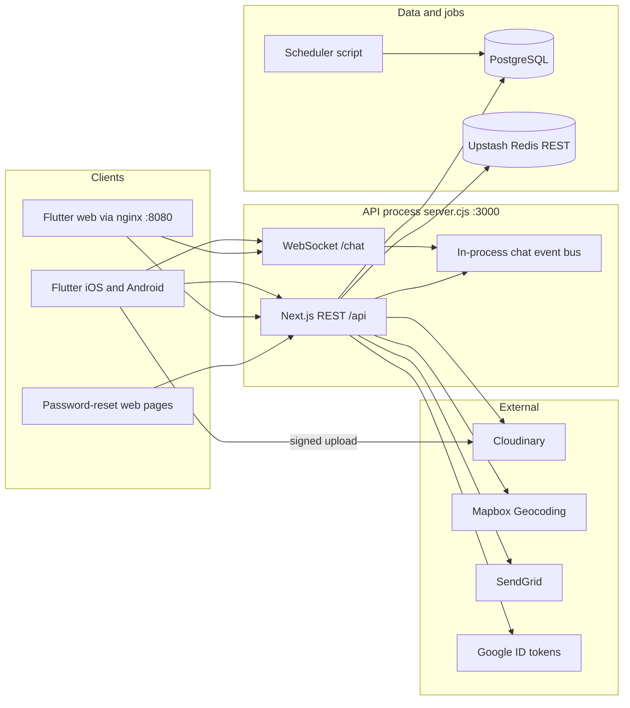
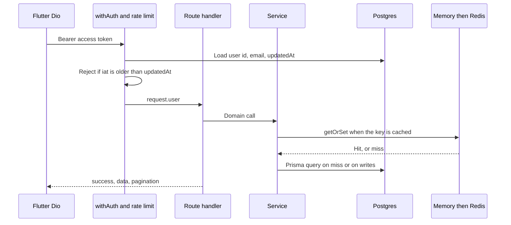

# System overview

TripThread is three processes that share one Postgres database, plus three external systems the API calls on behalf of the app.

The scheduler never talks to Redis. Chat fan-out never talks to Redis either. Both of those choices are deliberate and are documented in [Redis](./09-redis-cache-and-queues.md) and [Chat](./14-chat.md).

## Processes

### API (`server.cjs`)

`server.cjs` is the production entrypoint. It loads the chat event bus onto `global.chatEventBus`, hands HTTP to the Next.js request handler, and upgrades `GET /chat` to a WebSocket served by `dist/chat-ws.cjs` (compiled from `src/lib/chat-ws.ts` by `scripts/build-server.mjs`).

REST handlers live under `src/app/api/**/route.ts`. Business rules live in `src/lib/services/*` and `src/lib/*.ts`. Route files authenticate, rate-limit, validate, and call a service.

A typical authenticated read looks like this:

### Flutter app (`mobile/`)

State is `ChangeNotifier` providers (`AuthProvider`, `TripProvider`, `FeedProvider`, `ExpenseProvider`, `ChatProvider`, and others). Navigation is GoRouter. HTTP is Dio in `mobile/lib/services/api_service.dart`, with a single-flight refresh in `token_refresh_manager.dart`.

Tokens:

- iOS, Android, and desktop use `flutter_secure_storage` (`token_store_io.dart`), Keychain `first_unlock_this_device` on iOS.
- The Docker web build uses `shared_preferences` (`token_store_web.dart`). WebCrypto-backed secure storage was leaving the splash screen up after login, so the web session is browser local storage.

### Scheduler (`scheduler/`)

`scheduler/src/index.ts` connects to Postgres, runs `updateTripStatuses` once, and exits. Production cron invokes it (the documented cadence is hourly, `0 * * * *`). Docker Compose loops the same script every `SCHEDULER_INTERVAL_SECONDS` (default 300) after the API healthcheck passes. Details are in [Scheduler](./15-scheduler-and-ops.md).

## Deploy shape

| Environment | What runs |
| --- | --- |
| Production | Railway / Railpack. The Compose file is not the production runtime |
| Local full stack | `docker-compose.yml`: Postgres, API (`node server.cjs`), scheduler loop, Flutter web on nginx port 8080 |
| Local hybrid | `docker-compose.dev.yml`: Postgres only. Next.js and Flutter run on the host |

The API image entrypoint is `scripts/docker-entrypoint.sh`. It waits for Postgres, runs `prisma migrate deploy` (and baselines an old `db push` volume once), then execs `node server.cjs`.

Nginx on the web container proxies `/api`, `/chat`, `/share`, `/.well-known`, `/_next`, and the password-reset pages to the API. The WebSocket upgrade for `/chat` is configured there. The HTTP healthcheck hits `GET /api/health` and does not open a WebSocket.

## API envelope

Successful JSON is `{ success, data?, message? }`. Auth login and signup return `AuthResponse`: `{ user, accessToken, refreshToken }`. Failures are `{ success: false, error }` with the status from `AppError` (`src/lib/errors.ts`, `handleApiError` in `src/lib/middleware.ts`).

| Error class | HTTP |
| --- | --- |
| `ValidationError` | 400 |
| `AuthenticationError` | 401 |
| `AuthorizationError` | 403 |
| `NotFoundError` | 404 |
| `ConflictError`, `UnsettledBalanceError` | 409 |
| `RateLimitError` | 429 |
| Unhandled | 500 |

`UnsettledBalanceError` also returns `code: UNSETTLED_BALANCE` and `meta.netMinor`.

## Domain map

The API is one deployable, split by folder rather than by network service.

| Domain | Routes | Service modules |
| --- | --- | --- |
| Auth | `/api/auth/*` | `src/lib/auth.ts`, `passwordReset.ts`, `googleAuth.ts`, `token.ts` |
| Users | `/api/users/*` | route handlers plus privacy rules |
| Follow | `/api/follow/*` | route transactions |
| Trips | `/api/trips/*` | `tripSchedule.ts`, `tripValidation.ts`, `tripInvitation.ts`, `tripFinalizer.ts` |
| Expenses | `/api/trips/:id/expenses`, `settlements`, `expense-settings` | `src/lib/services/expense/*` |
| Media | `/api/media/*` | `src/lib/cloudinary.ts` |
| Places | `/api/places/*` | `src/lib/place.ts`, `mapProviders/mapbox.ts` |
| Feed | `/api/feed/*`, `/api/discover/trips` | route SQL plus `feedCursor.ts` |
| Engagement | `/api/likes`, `/api/comments`, `/api/shares`, `/api/posts` | `like.ts`, `comment.ts`, `share.ts` |
| Notifications | `/api/users/me/notifications` | `notification.ts` |
| Chat | `/api/chat/*` and `WS /chat` | `chat.ts`, `chat-ws.ts` |

## Concepts that show up everywhere

**Denormalized counters.** `likeCount`, `commentCount`, and `shareCount` live on the entity row. `Trip.entryCount` and `Trip.participantCount` live on the trip. Feeds and cards read the column. Writes update the column inside the same transaction as the like, comment, entry, or participant change. See [Optimizations](./18-optimizations.md).

**Keyset pagination.** Home feed, thread entries, notifications, likes, comments, and chat messages page with a cursor instead of a growing `OFFSET`. The cursor is base64url JSON of the sort key (usually `createdAt` plus `id`).

**Privacy.** `User.isPrivate` changes follow (immediate vs request), profile visibility, trip visibility, and who can be invited. There is no block or mute table.

**Membership.** The trip owner is `Trip.userId`. They are a billable member for expenses and tags, and they are prepended as a synthetic `owner` row on `GET /trips/:id/participants`. They are not inserted into `trip_participants` at create time.

**Money is a ledger.** Amounts are integers in minor units. Settlements record that a person marked a transfer as paid. No card, wallet, or payment provider is called. See [Expenses](./10-expenses-and-settlements.md).

## Known cross-cutting gaps

These are in the code today. They are documented so a reader does not "fix" the docs back to an intended design that was never wired.

1. The Flutter reset call sends `{ token, newPassword }`. The server schema also requires `currentPassword`. The web reset page sends the current password. See [Password reset](./02-password-reset.md).
2. The scheduler writes a final post with the schema default `generationStatus = DRAFT`. The API finalizer writes `READY`. See [Thread and final posts](./06-thread-and-final-posts.md).
3. `PasswordReset.otpCodeHash` and `OAuthProvider.APPLE` exist on the schema and are unused.
4. `recordSecurityEvent` is called with password-reset type strings that are not in the `SecurityEventType` enum. The insert fails and is swallowed.
5. Chat cannot fan out across API replicas until a real pub/sub transport exists. Upstash REST cannot `SUBSCRIBE`.
