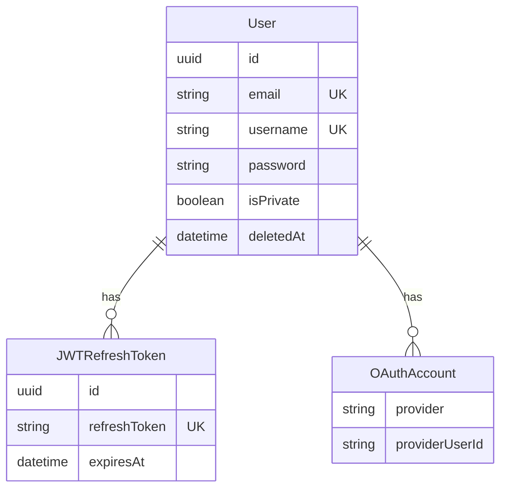
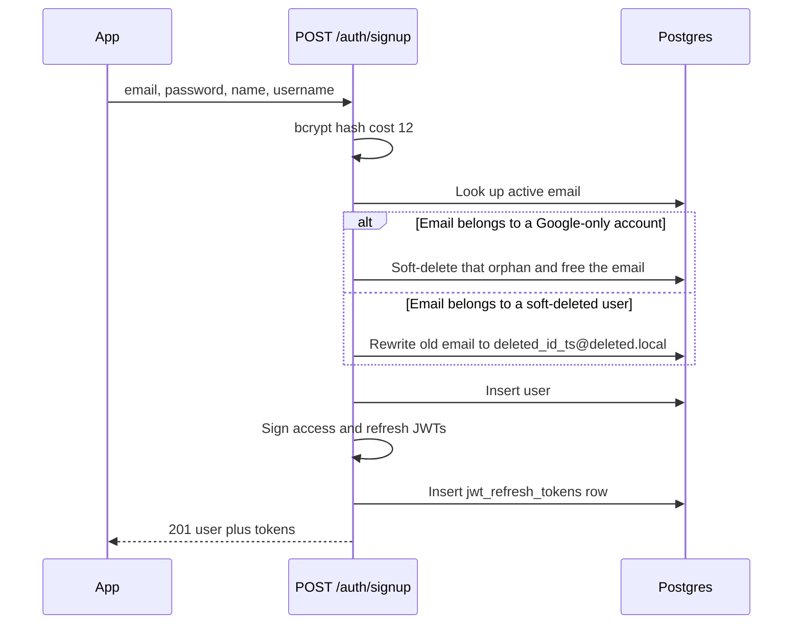
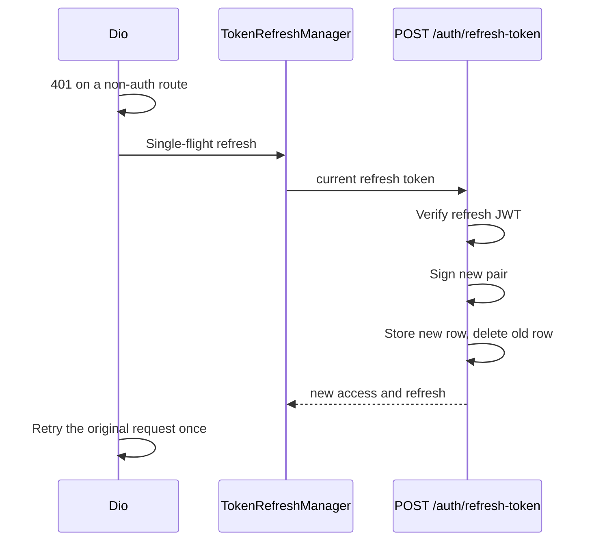

# Authentication

Email and password accounts, Google sign-in, and a rotating JWT pair. Profile completion is a second step for Google users who do not yet have a username.

Primary files:

- Routes: `src/app/api/auth/signup`, `login`, `google`, `link-google`, `complete-profile`, `logout`, `refresh-token`
- Tokens and passwords: `src/lib/auth.ts`, `src/lib/services/token.ts`
- Google: `src/lib/services/googleAuth.ts`
- Validation: `src/lib/validation.ts`, `src/lib/password-policy.ts`
- Mobile: `mobile/lib/providers/auth_provider.dart`, `api_service.dart`, `token_refresh_manager.dart`, `storage_service.dart`, `token_store_io.dart`, `token_store_web.dart`
- Screens: `mobile/lib/screens/auth/login_screen.dart`, `signup_screen.dart`, `complete_profile_screen.dart`
- Gate: `mobile/lib/widgets/auth_gate.dart`

## Concepts

**Access token.** HS256 JWT signed with `JWT_SECRET`, `expiresIn: 24h`. The payload carries the user id and email. `withAuth` also checks `iat` against `User.updatedAt` so a credential change invalidates outstanding access tokens within about a second.

**Refresh token.** Separate JWT signed with `JWT_REFRESH_SECRET`, `expiresIn: 30d`, and a `jwtid` (`jti`) of `randomUUID()`. The raw token string is stored in `jwt_refresh_tokens.refreshToken` (unique) with `expiresAt = now + 30 days`. Rotation writes the new row and deletes the presented token. A duplicate `jti` hits Prisma `P2002` and is rejected as a duplicate refresh token.

**Password.** bcrypt, cost factor 12 (`AuthService.hashPassword`, `config.bcryptRounds`). Policy: 8 to 128 characters, at least one lowercase letter, one uppercase letter, and one digit (`src/lib/password-policy.ts`).

**Username.** Normalized from Cyrillic and Greek lookalikes to ASCII, then stored lowercase. Length 3–30. Pattern `^[a-zA-Z0-9_]+$`.

**Profile completion.** A Google-created user can have `username = null` and `password = null`. `requiresProfileCompletion` is true until a username exists. `GET /users/me` reports `profileComplete` as username present and (a password exists, or the user has no OAuth accounts). `hasGoogleLinked` is true when an `OAuthAccount` with provider `GOOGLE` exists. `hasPassword` is a raw SQL `("password" IS NOT NULL)` so the hash itself is never selected into the response.

## Data model



`OAuthAccount` is unique on `(provider, providerUserId)`. `OAuthProvider` is `GOOGLE` or `APPLE`. Only Google is implemented.

`JWTRefreshToken` is indexed on `userId` and `expiresAt` so logout-all and expiry sweeps do not scan the table.

## Signup

`POST /api/auth/signup`. Body `{ email, password, name, username }`. Rate preset `auth_signup`: 100 requests per hour. Response **201** with `AuthResponse`.



A Google-only account (password null, at least one OAuth row) can be reclaimed by a later email signup. The orphan is soft-deleted so the email unique constraint is free. A previously soft-deleted row with the same email is renamed to `deleted_${id}_${timestamp}@deleted.local` before the new insert. That is how email reuse works without hard-deleting the old user id, which other rows may still reference historically.

## Login

`POST /api/auth/login`. The JSON field is named `email`, but the handler treats it as email **or** username.

```18:33:src/app/api/auth/login/route.ts
          const originalInput = body.email?.trim() || "";
          const isEmail = originalInput.includes("@");
```

If the string contains `@`, lookup is `findUnique({ email })`. Otherwise lookup is `findUnique({ username })`. Then `bcrypt.compare`. Missing user, missing password hash (Google-only account), and a bad password all return **401** `Invalid email or password`. The handler does not special-case `deletedAt`: deletion rewrites `email` and nulls `username`, so the old identifier no longer matches.

Rate preset `auth_login`: 100 requests per 15 minutes, keyed by IP when the caller is anonymous.

## Google sign-in

`POST /api/auth/google` with `{ idToken }`. `verifyGoogleIdToken` checks the token audience against `GOOGLE_CLIENT_ID` and times out at `GOOGLE_VERIFY_TIMEOUT_MS` (2500 ms). Timeout is **504**. A bad token is **401**. Rate preset `auth_google`: 30 per 15 minutes.

Resolution order:

1. Active user (`deletedAt` null) with that email. Link an `OAuthAccount` if one is missing. The link runs in a transaction and tolerates `P2002` if two requests race.
2. Else an `OAuthAccount` for `GOOGLE` plus the Google `sub`. If that user is soft-deleted, the OAuth row is removed and the request falls through to create a new user.
3. Else create a user with `username: null` and a nested OAuth row. The response includes `requiresProfileCompletion: true`.

`POST /api/auth/link-google` is authenticated (`auth_link_google`, 10 per 15 minutes). It rejects the link when that Google `sub` already belongs to a different active user (**400**). For `@gmail.com` and `@googlemail.com` accounts, the Google email must equal the account email.

`POST /api/auth/complete-profile` is authenticated (`auth_complete_profile`, 20 per 15 minutes). Body `{ username, password, name? }`. If the user has no password, they must already have an OAuth account. The handler sets the username (and password when provided) and issues a fresh token pair. Because `updatedAt` moves, older access tokens fail the `iat` check in `withAuth`.

## Refresh and logout



`POST /api/auth/refresh-token` uses preset `auth_refresh` (10 per hour). `TokenRefreshManager` collapses concurrent 401s into one refresh. A failed refresh is debounced for 5 seconds, then tokens are cleared and `AuthProvider.forceLogout` runs (`main.dart` wires `_onUnauthorized`).

The interceptor does not try to refresh a 401 from `/auth/login`, `/auth/signup`, `/auth/refresh-token`, `/auth/forgot-password`, or `/auth/reset-password`.

`POST /api/auth/logout` requires the access token. Body `{ refreshToken?, logoutAll? }`.

- `logoutAll: true` calls `revokeAllRefreshTokens(userId)` and deletes every refresh row for that user.
- Otherwise the presented refresh token is revoked.
- If `refreshToken` is omitted, the server logs a warning and does not revoke anything, so other devices stay signed in.

## Mobile session

| Piece | Behavior |
| --- | --- |
| Storage keys | `access_token`, `refresh_token`, `user_id` |
| Native | `FlutterSecureStorage` |
| Web | `SharedPreferences` |
| Gate | `AuthGate` sends signed-out users to `/login` and leaves the auth routes reachable |
| Google | `AuthProvider.signInWithGoogle` posts the Google ID token |
| Completion | `AuthProvider.requiresProfileCompletion` routes to `complete_profile_screen.dart` |

`src/lib/auth.ts` also reads an `auth_token` cookie via `getAuthSession()` for the Next.js password-reset pages. The Flutter client does not set that cookie. It sends `Authorization: Bearer`.

## Credential invalidation

`withAuth` (`src/lib/middleware.ts`) loads `id`, `email`, and `updatedAt`. If `payload.iat * 1000 < user.updatedAt.getTime() - 1000`, the access token is rejected. Password changes, profile updates that touch `updatedAt`, and complete-profile all move `updatedAt`, so stolen access tokens die on the next request after the change. Refresh tokens are deleted explicitly on password reset (`revokeAllRefreshTokens`) and on logout.

Secrets `JWT_SECRET` and `JWT_REFRESH_SECRET` must be at least 32 characters (`validateEnvironment` in `src/lib/security.ts`).
