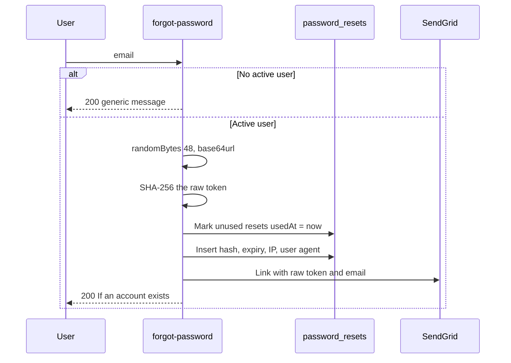

# Password reset

A single-use link, hashed at rest, locked with `SELECT FOR UPDATE`, and followed by revocation of every refresh token.

Primary files:

- `src/app/api/auth/forgot-password/route.ts`
- `src/app/api/auth/reset-password/route.ts`
- `src/app/api/auth/validate-reset-token/route.ts`
- `src/lib/services/passwordReset.ts`
- `src/lib/services/email.ts`
- `src/lib/deeplink.ts`
- `src/app/forgot-password/page.tsx`
- `src/middleware.ts` (reset page query check)
- `src/scripts/cleanupExpiredPasswordResets.ts`
- Mobile: `forgot_password_screen.dart`, `reset_password_screen.dart`, `AuthProvider.forgotPassword` / `resetPassword`

## Data model

`password_resets`:

| Column | Role |
| --- | --- |
| `tokenHash` | SHA-256 of the raw token. `Bytes`, unique. The raw token is never stored |
| `otpCodeHash` | Present on the schema. No route writes or reads it |
| `expiresAt` | `now + PASSWORD_RESET_TTL_MINUTES`. Default **15 minutes** (`src/config/env.ts`) |
| `usedAt` | Set when the token is consumed, and also set on older unused tokens when a newer reset is requested |
| `createdIp`, `userAgent` | Captured on request |
| Index | `(userId, expiresAt)` for the invalidate-previous-tokens update and for cleanup |

## Request a reset

`POST /api/auth/forgot-password`. Preset `auth_forgot`: **2 requests per hour**.



The response is always `{ ok: true, message: "If an account exists..." }` when the email is unknown or the user is deleted. That is the enumeration defense. A missing SendGrid key makes `sendPasswordResetEmail` a no-op rather than an error, so production must have `SENDGRID_API_KEY` or the user receives nothing and the API still says the mail was considered.

The link is built in `buildPasswordResetLink` (`src/lib/deeplink.ts`):

- App scheme: `APP_SCHEME://reset?t=<raw>&email=<email>`
- Web: `APP_RESET_WEB_URL` (default `https://app.tripthread.com/reset`) with the same query.

Development can echo the raw token when `PASSWORD_RESET_DEBUG_ECHO=1` or the request header `x-debug-echo: 1` is set (`debugToken` on the response). That must stay off in production.

`src/middleware.ts` only matches `/reset-success`, `/forgot-password`, and `/api/:path*`. For the reset pages it requires query `t` of length at least 16 and an `email` containing `@`, otherwise it redirects to `/?error=invalid-reset-link`. It does not check the hash. That check is `validate-reset-token`.

## Validate

`POST /api/auth/validate-reset-token`. Preset `auth_validate`: 20 per hour. Body `{ token (min 16), email, allowUsed? }`.

| Code | When |
| --- | --- |
| `invalid-token` | No row for the SHA-256 |
| `email-mismatch` | Row exists but `user.email` differs |
| `account-deleted` | `user.deletedAt` is set |
| `token-used` | `usedAt` is set and `allowUsed` is not true |
| `token-expired` | `expiresAt < now` |

The web page calls this before showing the form.

## Reset

`POST /api/auth/reset-password`. Preset `auth_reset`: **2 per hour**.

Server schema (`resetSchema` in `passwordReset.ts`):

- `token` min 16
- `currentPassword` required
- `newPassword` must pass the password policy and must differ from the current password

The transaction:

1. `SELECT ... FROM password_resets WHERE tokenHash = $1 FOR UPDATE`.
2. Reject missing, used, expired, deleted user, or a user with no password hash (Google-only accounts cannot complete this form until they have a password).
3. `bcrypt.compare(currentPassword, user.password)`.
4. Set `usedAt` **before** updating the password, so a crash cannot leave a valid token beside a new hash.
5. `bcrypt.hash(newPassword, 12)` and update the user.

After the transaction commits, `revokeAllRefreshTokens(userId)` deletes every refresh row. `sendSecurityEmail` notifies the address. `recordSecurityEvent` is called with string types `PASSWORD_RESET_REQUESTED`, `PASSWORD_RESET_SUCCESS`, and `PASSWORD_CHANGED`. Those strings are **not** members of the Prisma `SecurityEventType` enum (`COMMENT_REPORT`, `PROFANITY_DETECTED`, `RATE_LIMIT_HIT`, `ABUSE_DETECTED`, `UNAUTHORIZED_ACCESS`), and the call is `.catch(() => {})`. Those events do not persist. Rate-limit events, which use a real enum value, do persist. See [Security](./16-security-middleware.md).

## Email

`src/lib/services/email.ts` uses `@sendgrid/mail`.

| Env | Default |
| --- | --- |
| `SENDGRID_API_KEY` | none. Missing key means send is skipped |
| `MAIL_FROM` | `no-reply@your-domain` |
| `APP_NAME` | `TripThread` |

Two templates: the reset link (`sendPasswordResetEmail`, includes the TTL in minutes) and the "your password changed" notice (`sendSecurityEmail`).

## Retention

`cleanupExpiredResets` deletes rows that are used **or** expired, and whose `createdAt` is older than `RESET_RETENTION_DAYS` (default **7**). The script is `src/scripts/cleanupExpiredPasswordResets.ts`. It is not the trip scheduler. Recent used rows stay for the retention window so support can see that a reset happened, without keeping the raw token (only the hash was stored).

## Mobile and web contract

The web form (`src/app/forgot-password/page.tsx`) posts `token`, `email`, `currentPassword`, and `newPassword`.

The Flutter client does not. `ApiService.resetPassword` posts only `{ token, newPassword }`:

```571:580:mobile/lib/services/api_service.dart
  Future<ApiResponse<void>> resetPassword({
    required String token,
    required String newPassword,
  }) async {
    // ...
        data: {'token': token, 'newPassword': newPassword},
```

The server Zod schema requires `currentPassword`, so this mobile call is rejected with **400** until the client sends the current password. `AuthProvider.resetPassword` has the same two-argument shape. Forgot-password on mobile (requesting the email) matches the server and is fine.

After a successful reset the provider clears the local session, because the server has deleted every refresh token.
