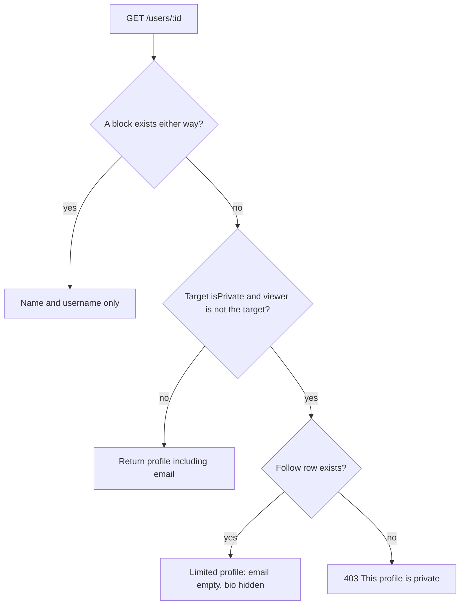
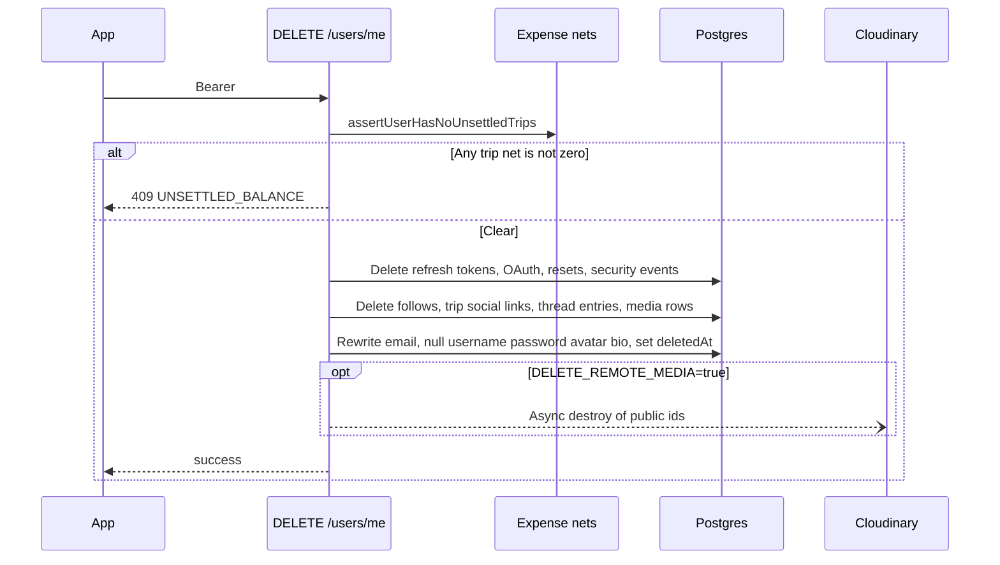

# Profiles and privacy

One `User` row is both the login identity and the public profile. Privacy is a single boolean, `isPrivate`, default `false`. There is no separate profile table. Block is not a second privacy flag. It is a `UserSafetyRelation` row. A block in either direction returns the same limited profile from `GET /users/:id`: name and username only. The photo, bio, and email are omitted. Stats, trips, and the follower and following lists are empty. `blockedByViewer` is set when the viewer blocked that person, so the screen can show Unblock. `viewerIsBlocked` is set when that person blocked the viewer. Search still returns the person, without a photo or bio. Restrict does not hide the profile. See [Follow](./04-follow-system.md).

Primary files:

- `src/app/api/users/me/route.ts` (`GET`, `PUT`, `DELETE`)
- `src/app/api/users/route.ts` (search)
- `src/app/api/users/[id]/route.ts`
- `src/app/api/users/[id]/privacy/route.ts`
- `src/app/api/users/[id]/stats/route.ts`
- `src/app/api/users/[id]/followers/route.ts`
- Mobile: `user_provider.dart`, `auth_provider.dart` (`togglePrivacy`, `deleteAccount`), profile screens

## Self profile

`GET /api/users/me` is `withAuth` plus rate preset `read_hot` (240 per minute). The select includes `oauthAccounts` and a raw expression `("password" IS NOT NULL) AS hasPassword`. The password hash is not returned.

Derived flags:

- `profileComplete` = username is set, and (password is set or there are zero OAuth accounts).
- `hasGoogleLinked` = some OAuth row has provider `GOOGLE`.

`PUT /api/users/me` uses `updateProfileSchema`: optional `name`, `username`, `bio` (max 200, empty string becomes null), `avatarUrl` (URL, max 2048), `isPrivate`. If the body touches `name`, `username`, or `bio`, the effective username after the update must be non-empty. That stops a completed profile from being wiped back to the Google onboarding state by accident. The update runs in a transaction. `updatedAt` moves, so older access tokens fail `withAuth` (see [Authentication](./01-authentication.md)).

## Public profile

`GET /api/users/:id` takes an optional bearer token (`getOptionalUser`).

A follower of a private account sees a reduced profile, not a 403. A stranger, including an anonymous caller, gets **403**.

`PUT /api/users/:id` is owner-only. `PATCH /api/users/:id/privacy` ignores the body and flips `isPrivate` to its opposite. The mobile toggle calls that PATCH.

`GET /api/users/:id/stats` is authenticated (`read_hot`) and returns `{ tripCount, followerCount, followingCount }` for any caller who is signed in. It does not apply the private-profile wall. Counts are `count()` queries, not denormalized columns on `User`.

`GET /api/users/:id/followers` hides the list of a private account unless the viewer and the target follow each other.

## Search

`GET /api/users?search=&page=&limit=&prioritizeFollowed=true`.

- Default page size 20, maximum 50.
- Case-insensitive `contains` on `username` and `name`.
- The current user is excluded.
- `deletedAt` is **not** filtered. Soft-deleted users have null usernames and rewritten emails, so they rarely match a name search, but the query itself does not exclude them.
- Each row is a `DiscoverUserDto` with `isFollowing` and `isFollowedBy`.
- This route does not use `withRateLimit`.

`UserProvider.searchUsers` drives discover-people in the app. Non-token metadata is cached on device in `metadata_cache_service.dart` via `shared_preferences`.

## Account deletion

`DELETE /api/users/me` is a soft delete with PII scrubbing, not a `DELETE FROM users`.

Guards and writes:

1. `assertUserHasNoUnsettledTrips` refuses the delete while any trip ledger net for this user is non-zero. The same 409 shape is used when leaving a trip. See [Expenses](./10-expenses-and-settlements.md).
2. Inside a transaction the handler deletes refresh tokens, OAuth accounts, password resets, security events, follow edges, trip social links, the user's thread entries, and media rows.
3. The user row is updated, not removed:
   - `email = deleted_${currentUserId}_${Date.now()}@deleted.local`
   - `username`, `password`, `avatarUrl`, `bio` set null
   - `deletedAt` and `deleteMeta` set
4. If `DELETE_REMOTE_MEDIA=true`, Cloudinary destroys run after the transaction, asynchronously. A Cloudinary failure does not roll back the account delete.

`AuthProvider.deleteAccount` then `clearTokens()`. Login with the old email fails because the unique email has been rewritten. A later signup with that email is allowed. See the reclaim path in [Authentication](./01-authentication.md).

## What privacy does not do

`isPrivate` does not hide the user from `GET /users` search, and it does not hide stats from an authenticated caller. It does change follow (request instead of instant follow), profile body, follower lists, trip visibility on feed and discover, and who may be invited onto a trip whose owner is private (the invitee must already follow the owner). Those rules are in [Follow](./04-follow-system.md) and [Feed](./11-feed-discover-posts.md).
