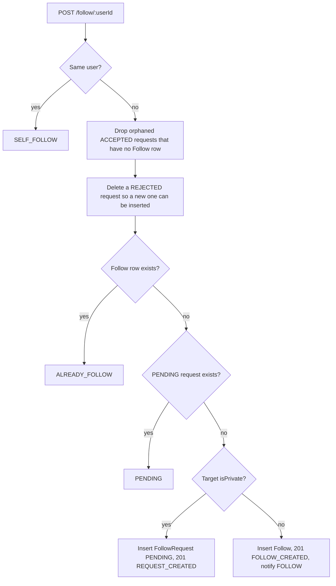

# Follow system

Public accounts are followed immediately. Private accounts produce a pending request that the followee accepts or rejects. Restrict and Block are a separate pair of actions, stored on `UserSafetyRelation`, not on `Follow`. There is no mute list and no close-friends list.

Primary files:

- `src/app/api/follow/[userId]/route.ts`
- `src/app/api/follow/requests/route.ts`
- `src/app/api/follow/requests/[requestId]/accept/route.ts`
- `src/app/api/follow/requests/[requestId]/reject/route.ts`
- `src/lib/services/notification.ts` (pending requests are merged into the inbox)
- Mobile: `user_provider.dart`, `follow_requests_screen.dart`

## Data model

| Model | Uniqueness | Extra index | Meaning |
| --- | --- | --- | --- |
| `Follow` | `(followerId, followeeId)` | `followeeId` | An accepted, active follow. `createdAt` is the follow time |
| `FollowRequest` | `(followerId, followeeId)` | `(followeeId, status, createdAt DESC)` | `PENDING`, `ACCEPTED`, or `REJECTED` |

The followee-status-time index is the pending inbox: "requests for me, status pending, newest first" is an index range scan, not a filter over every request. The followee index on `follows` is the followers list and the "does A follow B" check when B is the leading column. The unique pair is the "does A follow B" check when A is known.

Cascade deletes on both foreign keys mean account cleanup does not leave dangling edges. The delete handler also deletes follow edges explicitly before scrubbing the user.

## Follow

`GET /api/follow/:userId` returns `FollowStatusResponse`:

`{ isFollowing, isFollowedBy, isRequestPending, isPrivate, requestId?, requestStatus? }`

`POST /api/follow/:userId` runs in a transaction. Result codes: `NOT_FOUND`, `SELF_FOLLOW`, `ALREADY_FOLLOW`, `PENDING`, `REQUEST_CREATED`, `FOLLOW_CREATED`.

Unique violations become **409** through `handlePrismaUniqueError`.

On a public follow the handler fires `createNotification({ type: "FOLLOW", actorId, recipientId })` and does not await it. Accepting a private request does **not** write a `FOLLOW` notification. The pending request itself is what the recipient sees, and it disappears once it is no longer `PENDING`.

`POST` is rate-limited with the default `general` preset (100 per minute). `DELETE` uses the `write` preset (60 per minute).

## Unfollow and cancel

`DELETE /api/follow/:userId` deletes, in one transaction, every `Follow` and every `FollowRequest` between the pair. That covers unfollow, cancel-pending, and a leftover rejected row. The message distinguishes "unfollowed" from "request cancelled".

## Accept and reject

`GET /api/follow/requests` lists `PENDING` rows where `followeeId` is the caller, with the follower profile, `createdAt desc`. That query is the one the `(followeeId, status, createdAt DESC)` index serves.

`PUT /api/follow/requests/:requestId/accept` checks the caller is the followee and the row is `PENDING`, inserts `Follow`, and marks the request `ACCEPTED`.

`PUT .../reject` marks the request `REJECTED`. A later `POST /follow/:userId` deletes that rejected row before inserting a new pending request, because the unique pair would otherwise block a retry.

`POST /api/follow/requests` is a second entry point that always inserts a `FollowRequest` and does not take the public-account fast path. The mobile client uses `POST /follow/:userId`, which does.

## How other features use the follow edge

| Feature | Rule |
| --- | --- |
| Private profile | A follower sees a reduced profile. Everyone else gets 403. [Profiles](./03-profiles-and-privacy.md) |
| Home feed | Published final posts from self, from people you follow, and from every public account, except anyone in a block with the viewer and except someone who restricted the viewer. [Feed](./11-feed-discover-posts.md) |
| Discover and live trips | A private owner's trip is visible when you follow them or you are a member |
| Trip invite | If the trip owner is private, the invitee must already follow the owner. [Trips](./05-trip-lifecycle.md) |
| Notifications | Public follow writes `Notification` type `FOLLOW`. Pending requests are read from `follow_requests` and merged as synthetic `FOLLOW_REQUEST` items. [Notifications](./13-notifications.md) |

## Restrict and Block

`user_safety_relations` is unique on `(actorId, targetId)`. `action` is `RESTRICT` or `BLOCK`. Routes: `PUT` and `DELETE /api/users/:id/safety`, and `GET /api/users/me/safety` for the lists. The service is `src/lib/services/userSafety.ts`.

| Action | Direct messages | Follow and profile | Adding people |
| --- | --- | --- | --- |
| Restrict | Stopped both ways. The existing chat stays. Typing and read receipts stop in that direct message. The restricted person does not see the restrictor's last seen, group typing, or read receipts | The profile stays open, including posts opened from it. The restrictor's posts and trips leave the restricted person's Home, Discover, and live trips | Unchanged |
| Block | Stopped both ways, because any safety row stops a DM. Last seen, typing, and read receipts stop both ways | Follows and pending requests are deleted in both directions and are not restored. Neither person appears in search. The blocked person gets **404** `User not found`. The blocker gets a name and username with Unblock. Posts and trips leave both people's Home feed and Discover until Unblock | The creator of a trip or group cannot add the other person. A trip or group someone else created can still include both |

Downgrading a block to a restrict is rejected until the block is cleared. Blocking yourself is rejected. A follow attempt while a block exists either way returns **404** `User not found`, the same as a missing account. Unblock deletes the safety row. Posts and trips show again. Follows that Block removed are not put back.

The same sheet opens from another person's profile, a direct-message info screen, each member of a group or trip chat, and each person on Manage Participants. Settings lists blocked people and restricted people, and Help and FAQ (`help_faq_screen.dart`, `help_topics.dart`) holds the product rules.

## Mobile

`UserProvider` exposes `followUser`, `unfollowUser`, `cancelFollowRequest`, `acceptFollowRequest`, `rejectFollowRequest`, and `loadPendingFollowRequests`. The requests screen is `mobile/lib/screens/profile/follow_requests_screen.dart`. Optimistic UI updates the local `FollowStatus` and rolls back if the API returns a conflict.
