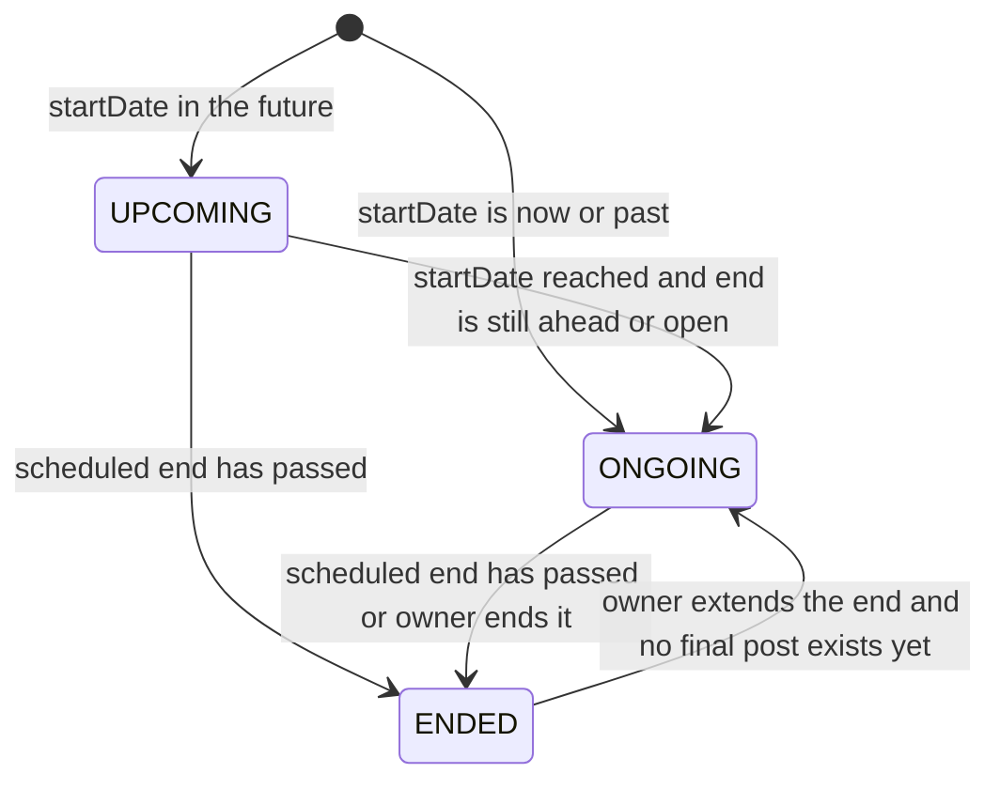

# Trip lifecycle

A trip is the aggregate root of the product. It has a schedule, a status, members, a thread, a money ledger, an optional final post, and an optional chat room.

Primary files:

- `src/app/api/trips/route.ts` and `src/app/api/trips/[id]/**`
- `src/lib/tripSchedule.ts`, `tripValidation.ts`, `tripInvitation.ts`, `tripSpendVisibility.ts`
- `scheduler/src/tripStatus.ts`, `scheduler/src/tripEnd.ts`
- Mobile: `trip_provider.dart`, `create_trip_screen.dart`, `trip_detail_screen.dart`, `trip_participants_screen.dart`

Thread content, the final post, and money have their own chapters: [Thread and final posts](./06-thread-and-final-posts.md), [Expenses](./10-expenses-and-settlements.md).

## Status

`TripStatus` is `UPCOMING`, `ONGOING`, or `ENDED`. Default on the column is `UPCOMING`. Create overwrites that from the start instant.

Instants are UTC `DateTime` values. `scheduleTimezone` is the IANA zone the user picked the wall time in. Legacy rows can have it null.

`scheduledEndInstant` (`src/lib/tripSchedule.ts`, duplicated in `scheduler/src/tripEnd.ts` because the scheduler cannot import the app package): if the wall-clock time in that zone is midnight, the stored end is treated as **23:59:59.999** that calendar day. A chosen non-midnight time is kept exactly. With no zone, UTC midnight expands to the end of the UTC day. This is why a date-only end means "through that day" rather than "at 00:00".

`nextTripStatus`:

- If the scheduled end is at or before now, the trip is `ENDED`. End wins over start.
- Else if status is `UPCOMING` and `startDate <= now`, it becomes `ONGOING`.
- `ENDED` does not move again inside this function. Reopening is only the dates PATCH.

Open-ended trips (`endDate` null) are never auto-ended. The scheduler's end batch requires a concrete end instant.

## Who moves the status

| Trigger | Where | Final post |
| --- | --- | --- |
| Create | `POST /trips` | No |
| Read catch-up | `syncViewerTripSchedule` on `GET /trips` and `GET /trips/status`. `syncTripById` on `GET /trips/:id` | Yes, via `TripFinalizerService`, status `READY`, when a trip is transitioned to `ENDED` |
| Hourly cron | `scheduler/src/tripStatus.ts` | Yes, inline insert, `generationStatus` left at schema default `DRAFT` |
| Owner ends | `POST /trips/:id/end` | Only if the trip was `ONGOING`. A `UPCOMING` end does not generate a post |
| Owner changes dates | `PATCH /trips/:id/dates` | No. Extending an `ENDED` trip that already has a final post is rejected |
| Replace on create | `updateMany` of conflicting trips to `ENDED` | No |

The read-path catch-up exists so a trip does not sit in the wrong status until the next cron tick. The scheduler is the backstop for trips nobody opens.

## Create

`POST /api/trips`. Auth plus rate preset `write` (60 per minute). Schema: `createTripSchema` in `src/lib/validation.ts`. Title, at least one `destinationPlaceIds`, optional start, end, `scheduleTimezone`, type, mood, and `coverMediaId`.

Rules:

- Omitted `startDate` becomes `now`, so the trip is born `ONGOING`.
- `endDate`, when set, is passed through `scheduledEndInstant`, must be after start, and must be in the future.
- Future start stores `UPCOMING`. Otherwise `ONGOING`.
- Omitted `type` stores `SOLO` and `typeSetByUser = false`. A provided type stores `typeSetByUser = true`.
- Cover media must exist, must be owned by the caller, and is linked with `media.tripId`.
- `participantCount` starts at 1 (the owner). The owner is **not** inserted into `trip_participants`.
- `ensureTripConversation` runs after create. A chat failure is logged and does not fail the trip.

### One active owned trip

`validateTripStatus` (`src/lib/tripValidation.ts`) looks only at trips this user **owns**, not trips they merely joined. A conflict is an owned trip that is `ONGOING`, or an owned trip that is `UPCOMING` or whose start is still in the future.

Without `replaceExisting: true` the response is **409** `ConflictError`. With the flag, those trip ids are `updateMany`'d to `ENDED`. That path does not generate final posts.

`GET /api/trips/check-conflicts` returns the same information for the create screen before submit. Mobile: `TripProvider` and `create_trip_screen.dart`.

## Read and access

`GET /api/trips` lists trips the caller owns or participates in. Optional `?status=`. It runs `syncViewerTripSchedule` first.

`GET /api/trips/status` returns the first `ONGOING` trip where the caller is owner or participant, or `data: null`.

`GET /api/trips/:id` allows the owner, a participant, anyone if the owner is public, and a follower if the owner is private. Otherwise **403**. Missing trip is **404**. `syncTripById` runs first. `omitHiddenTripSpend` strips `totalSpendMinor` unless the viewer is a member or `spendVisibleOnDiscover` is true.

## Dates

`PATCH /api/trips/:id/dates` is owner-only.

- `extending` is true when `body.extend === true` or the trip is already `ENDED`.
- An `ENDED` trip that already has a `TripFinalPost` cannot be extended (**400**).
- Start can change only while `UPCOMING`, and not into the past beyond a 2 minute skew.
- `endDate: null` makes the trip open-ended again.
- An extend must pass `endIsLater` (compare scheduled end instants, not raw timestamps, so the midnight expansion is honored).
- Status is recomputed: `UPCOMING` if start is still ahead, otherwise `ONGOING`. That is the only path that reopens `ENDED`.

## End, cover, leave

`POST /api/trips/:id/end` is owner-only. Allowed from `ONGOING` or `UPCOMING`. Already `ENDED` is **409**. The handler sets `status = ENDED` and `endDate = now`. A final post is generated only when the previous status was `ONGOING`.

`PATCH /api/trips/:id/cover` is owner or participant, trip `ONGOING` or `ENDED`, and the media must be an `IMAGE` the caller uploaded.

`POST /api/trips/:id/leave` is a non-owner participant. Body `{ removeMyData }`. `assertMemberZeroNetOnTrip` returns **409** `UNSETTLED_BALANCE` with `meta.netMinor` when the leaver's net is not zero. `removeMyData` on an `ONGOING` trip purges that author's entries through the bulk path in `threadEntryPurge.ts`. `participantCount` is decremented and `applyAutoTripType` runs. Leaving the trip does not get reversed by the next trip-chat sync. Leaving the chat room is a different action and does not leave the trip. See [Chat](./14-chat.md).

## Type

`TripType` is `SOLO`, `GROUP`, `COUPLE`, `FAMILY`.

`resolveTripType` in `tripSchedule.ts`: if `typeSetByUser` is true, the chosen type stays, including `COUPLE` and `FAMILY`. If it is false, `participantCount >= 2` becomes `GROUP` and otherwise `SOLO`. `applyAutoTripType` runs on add, remove, invite accept, and leave.

`TripMood` is `RELAXED`, `ADVENTURE`, `SPIRITUAL`, `CULTURAL`, `PARTY`, `MIXED`. Discover can filter on it.

## Participants and invites

`GET /api/trips/:id/participants` returns `trip_participants` rows and prepends a synthetic owner `{ role: "owner" }` when the owner is not in the table.

`POST /api/trips/:id/participants` is owner-only. If the owner is private, the added user must already follow the owner. `assertCreatorMayAdd` rejects the add when a block exists either way between the trip owner and that user. **201** on success. `participantCount` increments. The same creator check runs when an invite is accepted (`tripInvitation.ts`). A third person's trip can still include both people.

`DELETE /api/trips/:id/participants?userId=` is owner-only and uses the same unsettled-balance guard on the removed user.

Invites are `TripJoinRequest` rows, unique on `(tripId, receiverId)`, status `PENDING | ACCEPTED | REJECTED`. The product path is owner-invites-user. There is no "request to join" API.

| Route | Who |
| --- | --- |
| `POST /trips/:id/invites` | Owner sends |
| `GET /trips/:id/invites` | Owner lists |
| `DELETE /trips/:id/invites` | Owner withdraws |
| `GET /users/me/trip-invites` | Receiver inbox, pending |
| `POST /users/me/trip-invites/:id/accept` | Receiver. Inserts `TripParticipant`, increments `participantCount`, runs auto type |
| `POST /users/me/trip-invites/:id/reject` | Receiver |

The inbox query uses index `(receiverId, status)` from migration `20261004180000`.

## Map fields on the trip

Optional `startLocationId` and `endLocationId` point at `Place`. Optional `centerLat/Lng` and `boundNe*` / `boundSw*` are a precomputed camera. They are not a PostGIS geography. The client map reads places and thread locations and draws them itself. See [Places](./08-places-maps-location.md).

## Indexes on this path

| Index | Query |
| --- | --- |
| `(userId, status)` | My owned trips in a status. Conflict check |
| `(userId, createdAt DESC)` | My trips, newest first |
| `(status, endDate)` | Scheduler end batch |
| `(status, startDate)` | Scheduler start batch |
| `trip_participants (userId)` | Trips I joined |
| `trip_participants (tripId, userId)` unique | Membership test |
| `trip_join_requests (receiverId, status)` | Invite inbox |
| `trip_join_requests (tripId, receiverId)` unique | One invite per person per trip |

Why these exist, and what the queries did before them, is in [Optimizations](./18-optimizations.md).
