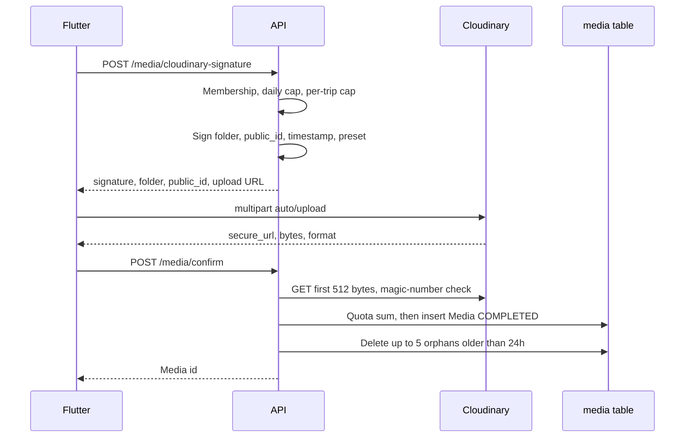

# Media and Cloudinary

Bytes never pass through the API. The API signs an upload, the phone posts the file to Cloudinary, then the API confirms the asset and inserts a `Media` row.

Primary files:

- `src/lib/cloudinary.ts`
- `src/lib/security.ts` (`validateFileUpload`)
- `src/app/api/media/cloudinary-signature/route.ts`
- `src/app/api/media/confirm/route.ts`
- `src/app/api/media/delete/route.ts`
- `src/app/api/media/quota/route.ts`
- `src/scripts/cleanup-orphan-media.ts`
- Mobile: `mobile/lib/services/media_service.dart`, `mobile/lib/utils/cloudinary_utils.dart`

## Flow

Signature, confirm, and delete use rate preset `media_upload`: **20 requests per 60 seconds**, Redis key `rl:media:{identifier}:{window}`.

## Signature

`POST /api/media/cloudinary-signature` body `{ filename, contentType, tripId?, usage }`.

`usage` is `trip_cover`, `thread_entry`, `general`, `chat`, or `group_avatar`. Default `general`.

If `tripId` is set, the caller must own or participate. The per-trip cap is checked here only.

Daily cap: count of `Media` rows by this user since UTC midnight, against `MEDIA_DAILY_UPLOAD_LIMIT` (default **200**).

`CloudinaryService.generateUploadSignature`:

- `validateFileUpload` sees the filename and MIME. Size is passed as `1` at sign time because the bytes are not here yet. The real size is checked at confirm.
- Folder: `{CLOUDINARY_UPLOAD_FOLDER}/{userId}[/{tripId}]/{usage}`. Default folder `tripthread_uploads`.
- `public_id`: `{timestamp}_{uuid}_{sanitizedBaseName}`. The base name is sanitized and cut at 60 characters.
- Signed fields: `folder`, `public_id`, `timestamp`, `upload_preset`.
- Preset (created in the Cloudinary dashboard, not by this API): video MIME maps to `"video"`, `trip_cover` to `"cover"`, `group_avatar` to `"avatar"`, everything else to `"tripthread_thread_image"`.
- Upload URL: `https://api.cloudinary.com/v1_1/{cloud}/auto/upload`.

Missing or placeholder Cloudinary credentials fail the route with **500**.

## Confirm

`POST /api/media/confirm` receives the Cloudinary response plus optional `tripId`, `chatMessageId`, and `usage`.

Checks, in order:

1. `secure_url` host matches the configured cloud name. A client cannot confirm an asset on someone else's cloud.
2. `validateFileUpload`: max **50 MB**. Images `image/jpeg`, `image/jpg`, `image/png`, `image/gif`. Video `video/mp4`, `video/mov`, `video/avi`. Filename `^[a-zA-Z0-9._-]+$`. Double extensions such as `file.jpg.exe` are rejected.
3. Format allowlist in `cloudinary.ts`: image `jpeg, jpg, png, gif`; video `mp4, mov, avi`; raw `mp3, wav, m4a, ogg, aac`. The raw formats are blocked in practice because `validateFileUpload` does not allow those MIME types.
4. Magic numbers. The server GETs the first 512 bytes of `secure_url` through `retry` (`maxRetries: 2`, `initialDelayMs: 500`, retry on 5xx and network errors). A detected type that disagrees with the claim is a `ValidationError`. An undetectable header is logged and allowed.
5. Storage quota. `sum(Media.size)` for the user plus the new `bytes`, compared with `MEDIA_TOTAL_STORAGE_LIMIT_BYTES` (default **5 GiB**). A limit of 0 disables the check.
6. If `chatMessageId` is set, the caller must be a participant of that message's conversation.

The row is inserted with `processingStatus: COMPLETED`. The enum also has `PENDING`, `PROCESSING`, and `FAILED`. The confirm path does not use them. There is no async transcode webhook.

Then `cleanupOrphanedMedia(userId)` deletes up to **5** of this user's media rows that have `tripId` null, no thread entries, and `createdAt` older than 24 hours.

## Delete

`POST /api/media/delete` with `{ publicId }`.

If a row exists, `uploadedById` must be the caller. If no row exists, the `public_id` must contain `"/{userId}/"` so a user can only name assets inside their own folder.

Order: `deleteMany` the database row first, then Cloudinary `destroy` with the same retry helper. A Cloudinary failure is logged. The database row is already gone, so the CDN object can be left behind. The orphan script is the sweep for the opposite case (row without a live parent).

## Quota

`GET /api/media/quota` returns:

- `storage.used`, `storage.quota`, `storage.percentUsed`
- `daily.uploaded`, `daily.limit`, `daily.remaining`
- `total.mediaCount`

The daily window is UTC midnight, matching the signature gate.

## Orphan script

`src/scripts/cleanup-orphan-media.ts` selects media with no chat message, not used as a trip cover, and no thread entries, older than `--hours` (default 24). It prints them unless `--apply` is passed. Cap **500** rows per run. This is an operator script, not the scheduler.

## Mobile

`media_service.dart`:

- Queue of at most **3** concurrent prepares.
- Cloudinary multipart upload retries at most **2** times, backoff `500 * attempt` milliseconds.
- If confirm fails, the client calls the delete API so the CDN object does not stay unsigned-in-our-database.
- Image pick: max 1920×1080 at quality 85.
- Video pick: max **10 minutes**.
- Multi-select: max **10** files.

`cloudinary_utils.dart` rewrites delivery URLs on the client. The server stores the original `secure_url`.

- Images: `f_auto,q_auto`, optional `w_`, `h_`, `c_limit`.
- Video: `f_auto,q_auto,vc_auto`, optional width and `c_limit`.
- Thumbnail: `so_0` and a `.jpg` suffix on the last path segment, so a video poster is a single frame.

## Where media is referenced

| Parent | Column |
| --- | --- |
| Thread entry | `TripThreadEntry.mediaId`, `onDelete: SetNull` |
| Trip cover | `Trip.coverMediaId`, relation `TripCoverMedia`, `onDelete: SetNull` |
| Chat message | `Media.chatMessageId`, `onDelete: SetNull` |
| Uploader | `uploadedById`, cascade on user delete |

Indexes: unique `publicId`, `(uploadedById, createdAt DESC)` for quota and gallery, `tripId` for "media on this trip", `chatMessageId` for attachments.

`MediaType` is `IMAGE`, `VIDEO`, `AUDIO`, `GIF`. Confirm's MIME list effectively admits images and videos.

## Limits summary

| Limit | Default | Enforced |
| --- | --- | --- |
| File size | 50 MB | Confirm |
| Daily uploads | 200 | Signature and quota |
| Per trip | 500 (`MEDIA_PER_TRIP_LIMIT`) | Signature, when `tripId` is set |
| Account storage | 5 GiB | Confirm |
| Upload rate | 20 / minute | Middleware |
