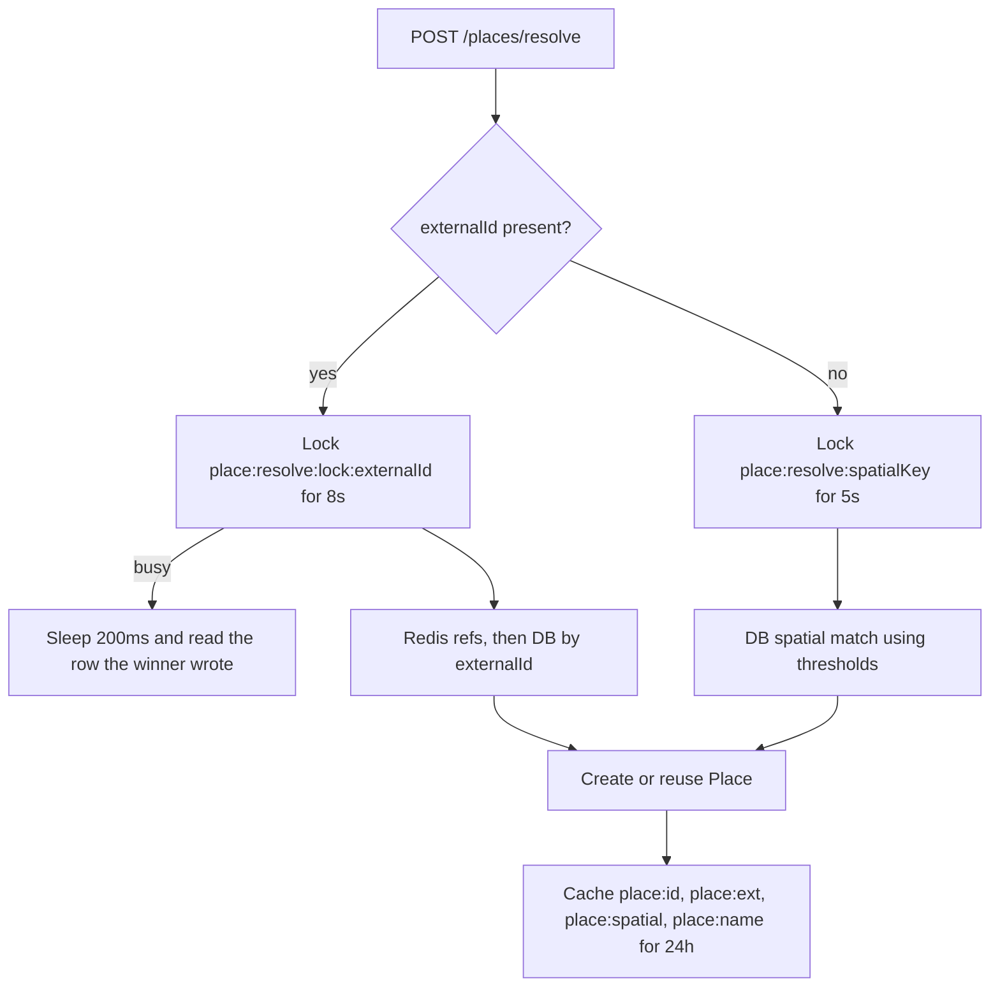

# Places, maps, and location

Place identity is resolved on the server and stored once in Postgres. Map tiles and the pin gesture run on the device. Reverse geocoding of a dropped pin uses the platform geocoder, not Mapbox.

Primary files:

- `src/lib/place.ts`
- `src/lib/mapProviders/adapter.ts`, `mapbox.ts`
- `src/lib/cache.ts`, `cacheUtils.ts`, `mutex.ts`
- `src/app/api/places/search/route.ts`, `resolve/route.ts`, `[id]/route.ts`
- Mobile: `places_service.dart`, `place_provider.dart`, `location_service.dart`, `map_place_label.dart`, `trip_map_screen.dart`, `map_picker_sheet_mobile.dart`, `app_permissions.dart`

## Two Mapbox uses, plus one geocoder

| Job | Who calls | API |
| --- | --- | --- |
| Search as the user types a destination | API, `MapboxPlacesAdapter` | Geocoding v6 forward: `https://api.mapbox.com/search/geocode/v6/forward` |
| Draw the trip and the pin dropper | Flutter `mapbox_maps_flutter` 3.34.2 | Style `mapbox://styles/mapbox/streets-v12` |
| Thumbnail on a location entry | Flutter builds the URL | Mapbox Static Images, `pin-s+1d6fe8`, `640x280@2x`, zoom 14 |
| Name a dropped pin | Device `geocoding` package | `placemarkFromCoordinates`. Not Mapbox |

The server token is `MAPBOX_ACCESS_TOKEN` on the API. The map token is a compile-time `MAPBOX_ACCESS_TOKEN` in the Flutter build (`AppConfig.mapboxAccessToken`). The Docker web image has to be built with a real token or the map is blank. iOS needs Swift Package Manager and iOS 14 for this Mapbox SDK.

Search timeout is **2000 ms**. Failure throws `MapboxRequestError`. The call is wrapped by the shared `retry` helper used for Cloudinary as well (`src/lib/retry.ts`).

`NormalizedPlace` in `adapter.ts` is the provider-neutral shape: name, address, lat, lng, external id, and a coarse type. `mapbox.ts` reads `feature.id` as `externalId` and maps `feature_type` / category onto that type. `CITY` and `DISTRICT` from Mapbox become Prisma `PlaceType.OTHER`. The other stored types are `POI`, `STAY`, `FOOD`, `TRANSPORT`, `VIEWPOINT`.

`PlaceSource` is `USER`, `GOOGLE`, `MAPBOX`, or `APPLE`. Search results from this adapter are stored as `MAPBOX`. A pin confirmed from the device is `USER` unless the client passes another source.

## Data model

`Place`: `name`, `address`, `lat`, `lng`, `placeType`, `source`, `externalId` unique.

Indexes:

- `coordinate_spatial_idx` on `(lat, lng)`. This is a btree, not PostGIS. It supports "places near this point" when the query also bounds the box. It does not do radius search by itself.
- `external_id_idx` on `externalId`, plus the unique constraint, so a Mapbox feature id resolves to one row.

`PlaceOnTrip`: a visit. Unique `(tripId, placeId, visitedAt)`. Optional `dayIndex`, `notes`, `order`. Index `trip_visits_idx` on `(tripId, visitedAt)` for the trip timeline. Routes: `GET/POST /api/trips/:id/places`, `DELETE /api/trips/:id/places/:placeOnTripId`.

`PlaceShare`: a tokenized link to a place, optionally tied to a trip and a thread entry. `token` is unique. There is **no** public REST controller for it. Rows are created with place-share helpers and deleted when the user or the thread entry is purged.

Trip start and end locations are nullable foreign keys `startLocationId` and `endLocationId`.

## Search

`GET /api/places/search?q=&lat=&lng=&limit=`. Optional auth. Rate preset `places`: **100 per minute**, key prefix `rl:places`. `q` minimum length **2**.

`searchPlaces` in `place.ts`:

1. Cache key `plc:srch:{query}:{bucketed lat or null}:{bucketed lng or null}:{limit}`. TTL **900 seconds**.
2. On miss, `contains` search on name and address in Postgres.
3. If the database has hits, cache them and return.
4. If not, call Mapbox, then dedupe each feature against existing rows (external id, then a spatial fuzzy match), upsert, and cache.

The search route then **resolves each hit** so the client receives stable TripThread UUIDs, not only Mapbox feature ids. The phone sends device coordinates from `LocationService` as the proximity bias (`proximity={lng},{lat}` on the Mapbox URL, longitude first).

`bucketCoord` rounds to 4 decimal places and base62-encodes the number (`cacheUtils.ts`), so nearby keystrokes share a cache entry instead of one key per GPS jitter.

## Resolve

`POST /api/places/resolve` is authenticated, same `places` rate limit. Body: name, lat, lng, optional address, externalId, placeType, source. The pin dropper calls this after the user confirms.

Spatial key precision depends on type: city 2 decimal degrees (about 1.1 km), district 3, POI 4.

Match thresholds, in degrees:

| Type | Distance | Name |
| --- | --- | --- |
| City | 0.03 | similarity 0.8, or distance alone |
| District | 0.01 | same idea, tighter box |
| POI | 0.001 | Levenshtein similarity at least 0.7, distance is not enough by itself |

Name similarity stops two different shops on the same block from collapsing into one `Place`. Cities are allowed to collapse on distance because Mapbox and a dropped pin rarely share a name string.

Locks are `acquireLock` / `withLock` in `mutex.ts`. They exist so two users resolving "the airport" at the same moment do not insert two rows. The loser waits and reads.

Cache refs, TTL **86400 seconds**, written by `cacheResults`:

| Key | Value |
| --- | --- |
| `place:{uuid}` | Full place JSON |
| `place:ext:{externalId}` | UUID |
| `place:spatial:{spatialKey}` | UUID |
| `place:name:{nameLower}:{spatialKey}` | UUID |

`src/lib/cacheUtils.ts` also defines a shorter scheme (`p:{id}`, `p:e:`, `p:q:`). The live path in `place.ts` uses the `place:*` and `plc:srch:*` keys. `invalidatePlaceCache` deletes `place:external:{id}` while writes use `place:ext:{id}`. Invalidation of the external-id ref does not hit the key that was written. Search and resolve still go stale only when the 24 hour TTL ends, unless the caller deletes `place:{id}` directly.

`GET /api/places/:id` is public and is a `findUnique`. It does not consult the cache.

`warmPlaceCache` and `getPopularPlaces` back `POST /api/admin/cache/warm` (default 100 places, max 500). Scoring lives in `place.ts`.

## Device map

`trip_map_screen.dart`:

- Native iOS and Android use `CircleAnnotationManager`, `PointAnnotationManager`, and `PolylineAnnotationManager`.
- Web (`kIsWeb`) does not. Those annotation managers throw on web. The web map adds GeoJSON sources: `trip-places` (circle layer plus symbol labels) and `trip-route` (line layer).

`map_picker_sheet_mobile.dart`:

- `MapWidget` with `TapInteraction.onMap`.
- The camera center is read from `CameraChangedEventData`, debounced 50 ms, so the pin label tracks the crosshair rather than only the tap point.
- Current location: `Geolocator.getCurrentPosition`, medium accuracy, 5 second limit inside a 7 second timeout.
- `labelForPin` (`map_place_label.dart`) calls `placemarkFromCoordinates` and caches the label in memory keyed to 4-decimal lat/lng.
- Confirm calls `PlaceProvider.resolvePlace`, which posts `/api/places/resolve`.

## Permission

`app_permissions.dart` requests `Permission.locationWhenInUse`. There is no background location permission and no background tracking. The copy in the UI says location is used while the map is open. On web the permission helper treats location as granted and lets the browser prompt.

Camera, photos, and video are requested at the moment of capture, not at launch. That is separate from the map but it is the same permission policy: ask when the feature is used.

## Caching layer under places

`src/lib/cache.ts` is the L1/L2 used by place search, distinct from `getOrSet` in `src/lib/redis.ts` (used by notifications and share tokens).

- L1: in-process LRU, max **1000** entries. When a value is copied from Redis into memory, the memory TTL is **5 minutes**.
- L2: Upstash REST `POST {REDIS_REST_URL}/pipeline` and `/get`.
- If Upstash returns a billing or rate-limit error, place caching backs off for **1 hour** and serves memory only.

The Redis chapter explains the circuit breaker and why the scheduler does not use this. [Redis](./09-redis-cache-and-queues.md).
