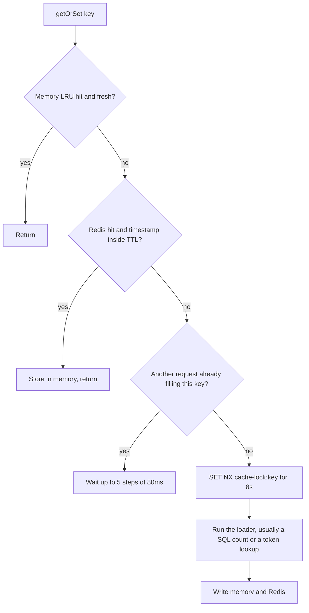

# Redis, cache, and queues

Upstash Redis is a cache, a lock store, and a fixed-window rate-limit counter. It is not a job queue. The trip scheduler does not open a Redis connection. Chat does not publish through Redis.

Primary files:

- `src/lib/redis.ts` (`@upstash/redis`, `getOrSet`, memory LRU)
- `src/lib/cache.ts` (REST fetch used by places)
- `src/lib/redisGuard.ts`
- `src/lib/rateLimit.ts`
- `src/lib/mutex.ts`
- `src/app/api/debug/redis/route.ts`
- `src/app/api/admin/cache/metrics/route.ts`
- `src/app/api/admin/cache/warm/route.ts`
- History of the queue removal: `scheduler/SCHEDULER_ARCHITECTURE.md`

Credentials are `REDIS_REST_URL` and `REDIS_REST_TOKEN`. Both clients read that pair. If the variables are missing, callers fall through to in-process memory. The API still boots.

## Why there are two clients

| Module | Client | Used for |
| --- | --- | --- |
| `src/lib/cache.ts` | Hand-rolled REST (`GET` and `pipeline`) | Place JSON, search results, place metrics, mutex fallback |
| `src/lib/redis.ts` | `@upstash/redis` | `getOrSet`, share tokens, notification unread counts, rate-limit `INCR` |

They do not share a connection pool because one is HTTP fetch and the other is the official SDK, but they hit the same database. A key written by one is visible to the other.

## Two-tier read

`getOrSet` stores `{ data, timestamp }` and checks the TTL in process, so a Redis entry that outlived its logical TTL is treated as a miss even if Redis has not expired it yet. Default TTL if the caller omits one is **3,600,000 ms** (1 hour).

The lock key is `cache-lock:{key}` with `NX` and an 8 second expiry. `shouldWaitForPeerCacheFill` is the stampede control: concurrent misses wait briefly for the winner instead of all running the loader.

The place cache in `cache.ts` is the same idea with different keys. Memory holds at most **1000** entries. A value promoted from Redis lives in memory for **5 minutes**. Upstash billing or HTTP rate-limit errors set a flag that disables Redis calls for **1 hour**.

## Circuit breaker

`redisGuard.ts` wraps Redis operations with a **250 ms** deadline. On failure it opens the circuit for **30 seconds**. It also opens when `cache.ts` has set the Upstash rate-limit flag. While the circuit is open, rate limiting and `getOrSet` use memory only. A Redis outage slows the API by at most one 250 ms timeout per op, then degrades, instead of hanging every request on the Upstash REST timeout.

## Keys that are actually read

| Key | TTL | Reader |
| --- | --- | --- |
| `plc:srch:{query}:{lat}:{lng}:{limit}` | 900 s | Place search |
| `place:{uuid}` and `place:ext:`, `place:spatial:`, `place:name:` | 86400 s | Place resolve |
| `notif:unread:{recipientId}` | 20 s | Unread badge |
| `shareToken:{token}` | Until `expiresAt`, or 1 hour | Share open |
| `rl:{preset}:{id}:{window}` | The window, via `PEXPIRE` | Fixed-window rate limit |
| `mutex:{key}` | Lock TTL, milliseconds | Place resolve locks |
| `cache-lock:{key}` | 8 s | `getOrSet` stampede |

`rl:sw:{id}` implements a sliding window and is not selected by the middleware. The comment in `rateLimit.ts` leaves it as a future switch. Every preset below is a fixed window: `INCR` and, on the first hit, `PEXPIRE`.

`{like|comment|share}Count:{entityType}:{entityId}` is deleted by `invalidateEngagementCache` on write. No reader calls `getOrSet` on those keys. Feeds read the counter columns on the entity row. The delete is harmless and currently does not save a query. See [Optimizations](./18-optimizations.md).

## Rate-limit presets

Identifier is the authenticated user id when the middleware was given one, otherwise the first `x-forwarded-for` or `x-real-ip`, otherwise `"unknown"`.

| Preset | Limit | Window |
| --- | --- | --- |
| `auth_login` | 100 | 15 min |
| `auth_signup` | 100 | 1 hour |
| `auth_forgot`, `auth_reset` | 2 | 1 hour |
| `auth_refresh` | 10 | 1 hour |
| `auth_validate` | 20 | 1 hour |
| `auth_google` | 30 | 15 min |
| `auth_complete_profile` | 20 | 15 min |
| `auth_link_google` | 10 | 15 min |
| `general` | 100 | 1 min |
| `write` | 60 | 1 min |
| `read_hot` | 240 | 1 min |
| `search` | 30 | 1 min |
| `places` | 100 | 1 min |
| `media_upload` | 20 | 1 min |
| `chat_message` | 30 | 1 min |

A 429 sets `Retry-After` and `X-RateLimit-*`. When the preset asks for it, the hit is also a `SecurityEvent` of type `RATE_LIMIT_HIT`. If the limiter itself throws, the request is **allowed** (fail open), except a misconfiguration which is **500**. That choice prefers availability over a hard stop when Redis and the memory fallback both error.

## What is not queued

BullMQ, `Queue`, and Redis lists used as job queues do not appear in the application code. The scheduler used to be a BullMQ worker. It was replaced by a script that runs once and exits, specifically so the Redis command budget stays available for cache and rate limits. `scheduler/src/startup-logger.ts` logs that there is no Redis dependency.

Chat participant ids are cached in an in-process LRU: 30 second TTL, max 2000 conversations (`getCachedParticipantIds` in `src/lib/services/chat.ts`). That map is not Redis. The chat event bus is `global.chatEventBus` inside one Node process. A second API replica would not see those events. The code comment in `src/lib/chat-events.ts` says the next step is Redis pub/sub, and that Upstash REST cannot `SUBSCRIBE`. Scaling chat past one container requires a different transport. See [Chat](./14-chat.md).

`PerformanceMonitor` and `ErrorTracker` (`src/lib/monitoring.ts`) keep the last 100 timings and the last 1000 errors in memory. They are not shipped to Redis, Sentry, Datadog, or OpenTelemetry.

## Operations endpoints

| Route | Behavior |
| --- | --- |
| `GET/POST /api/debug/redis` | Non-production only. `diagnoseRedisConnection`, `testRedisCommand`, clear the Upstash backoff flag |
| `GET/POST /api/admin/cache/metrics` | In-process hit and miss counters from the place cache. POST `action: reset` zeroes them |
| `GET/POST /api/admin/cache/warm` | `warmPlaceCache`, default 100 places, max 500 |

These are not on the mobile client. Treat them as operator routes.

## How this helps

Place search is the hot external call. A 15 minute search cache and a 24 hour identity cache mean Mapbox is called when the query is new, not on every keystroke of every user. The spatial lock means the cache also protects the unique constraint: the second resolver waits instead of inserting a duplicate and catching `P2002` after a Mapbox round trip.

The unread badge is cached for 20 seconds because the inbox screen and the tab badge both ask for it, and a 20 second stale count is acceptable. Writes delete `notif:unread:{id}` so a new like still updates the badge on the next fetch.

Rate limits live in Redis so two API processes (if you ever run two for HTTP) share one counter. Chat fan-out does not get that property today, and the docs should not imply that it does.
