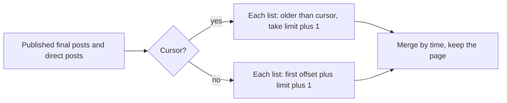

# Feed, discover, and posts

Three read models sit on top of trips and final posts.

| Surface | Route | What it lists |
| --- | --- | --- |
| Home | `GET /api/feed/home` | Published final posts and direct posts |
| Happening now | `GET /api/feed/live-trips` | One ongoing trip per person, story rail |
| Discover | `GET /api/discover/trips` | Other people's ongoing and ended trips, ranked |
| Deeplink | `GET /api/posts/:entityType/:entityId` | One published final post or direct post |

Primary files: `src/app/api/feed/home/route.ts`, `src/app/api/feed/live-trips/route.ts`, `src/app/api/discover/trips/route.ts`, `src/app/api/posts/[entityType]/[entityId]/route.ts`, `src/lib/feedCursor.ts`, `src/lib/feedCardPreview.ts`, `src/lib/tripSpendVisibility.ts`, `mobile/lib/providers/feed_provider.dart`, `mobile/lib/widgets/feed/final_post_feed_card.dart`.

There is also a `src/app/api/feed` mention of discover in older docs. The live discover route is `/api/discover/trips`, not under `/feed`.

## Home feed

Authenticated, rate preset `read_hot` (240 per minute), timer name `get_home_feed`.

A post is included when `isPublished` is true and the post author (`TripFinalPost.userId`, not the trip owner) is any of:

1. The viewer.
2. Someone the viewer follows.
3. A public account (`isPrivate = false`).

The three conditions are `OR`. Public posts are on the home feed even when the viewer does not follow the author. Private authors appear only as self or as a follow. The same audience applies to direct posts (`user_posts`), which have no trip. A direct post is a caption, up to 12 photos the author uploaded from their phone, and an optional location name and coordinates. Home merges the two lists by `createdAt` and id, and marks those rows with `postKind: "direct"`. `feedHiddenUserIds` then excludes every author in a block with the viewer, in either direction, and every author who restricted the viewer, with `userId: { notIn }`. A restrict does not hide the restricted person's posts from the restrictor. It does not make `canViewEntity` refuse the restrictor's final post or direct post. The profile lists that final post, and `GET /posts/TRIP_FINAL_POST/:id` returns it. Home, Discover, live trips, and search are the surfaces that omit the restrictor's posts, including a direct post. The profile returned to the restricted person keeps photo and bio. Only a block hides them. Unblock, or clearing the restrict, removes the feed exclusion. The mobile provider also drops items that look private and unfollowed, in case a stale client cache disagrees with the server.

### Feed card templates and previews

Each home-feed item carries:

| Field | Source | Role |
| --- | --- | --- |
| `templateChoice` | `trip_final_posts` / `user_posts` | `postcard`, `map_first`, or `thread_reel` |
| `threadPreview` | `loadFeedThreadPreviews` in `feedCardPreview.ts` | Up to 20 ranked thread snippets per trip (likeCount, then createdAt). Empty for direct posts |
| `mapPins` | `loadFeedMapPins` | Up to 8 pins from trip location entries, or the direct post's optional coordinates |

One windowed SQL pass ranks thread entries per trip, then a single Prisma hydrate loads media and place for those ids. Flutter renders `FinalPostFeedCard` with three bodies. Map layouts need a real `MAPBOX_ACCESS_TOKEN` in the web image build; a placeholder token shows the configuration message instead of tiles. Direct posts preview through `post_preview_screen.dart` before publish.

Pagination: the app sends `cursor`. `page` and `limit` (1–100, default 20) still work. `feedCursor.ts` encodes base64url `{ createdAt, id }`. A cursor asks each list for the next `limit + 1` rows older than that `(createdAt, id)` pair. A page number, with no cursor, asks each list for its first `offset + limit + 1` rows and does not skip inside either table. Home merges those rows by `createdAt` and id, then keeps the page. Skipping `offset` rows in each table before the merge would drop a post that belongs on the later page. `hasNext` is true when the merged window still has a row after this page, and `nextCursor` is the last returned row. `total` is the sum of the two audience counts. The mobile client keeps `nextCursor` and sends it on the next page.

`Promise.all` runs both audience counts and both pages together. The card does not call `_count` for entries or participants. It reads `Trip.entryCount` and `Trip.participantCount`. Likes on the trip posts are one `checkLikeStatus(userId, TRIP_FINAL_POST, ids)`. Direct posts use the same check for `USER_POST`.

`FeedProvider` stores `_homeFeedCursor` and sends it on load-more. It only advances `page` when the response has no `nextCursor`, so old servers and new servers both work. Like state is copied into `EngagementProvider` unless a toggle for that id is already in flight, so a feed refresh does not clobber a tap that has not returned.

## Live trips

`GET /api/feed/live-trips`. Default rate preset (`general`), not `read_hot`.

Query: `status = ONGOING`, and the owner or a participant is the viewer or someone they follow. `take: 60`, `orderBy: updatedAt desc`.

Then in memory:

- Keep the trip if the viewer is owner or participant, or follows the owner, or the owner is public. Drop a story whose person is in `feedHiddenUserIds` (a block either way, or someone who restricted the viewer).
- Deduplicate to one trip per user id. The viewer's own trip wins. For a followee, their owned trip wins over a trip they only joined.
- Sort the viewer first, then by `updatedAt`.

Spend uses `omitHiddenTripSpend` with the real membership flag. The rail is "Happening now" on the home screen. `FeedProvider.loadLiveTrips` calls `ApiService.getLiveTrips`.

The 60 row cap is a bound on work, not a product promise that a user with more than 60 live follows sees all of them. Dedup happens after the cap, so a very active graph can drop a followee who sorted below the cut.

## Discover

`GET /api/discover/trips`. `read_hot`.

Excludes the viewer's own trips (`userId != currentUserId`). Default statuses are `ONGOING` and `ENDED` (upcoming trips stay off discover). Optional `status`, `mood`, and `q`. `q` is trimmed to 80 characters and matched with `ILIKE` against title, description, owner name, username, and destinations.

Audience `OR`: the owner is someone the viewer follows, or the owner is public. The ranked SQL also excludes owners in `feedHiddenUserIds` (a block either way, or someone who restricted the viewer). `GET /api/users` omits a blocked person entirely. Someone who restricted the viewer still appears in that viewer's search, with photo and bio. The restrictor's own search still shows the restricted person as usual.

Ranking is raw SQL, then a single Prisma `findMany` by those ids:

1. Followed owners first (`followedRank`).
2. `(entryCount + participantCount) DESC`.
3. `ONGOING` before `ENDED`.
4. `updatedAt DESC`.

The id list is applied in memory with a `Map` so Prisma's `IN` clause cannot reorder the page. That is one ranked query plus one hydration query, not one query per trip.

Pagination is offset. `hasNext = offset + limit < total`. There is no discover cursor.

Spend is passed through `omitHiddenTripSpend(trip, false)`. Discover never treats the viewer as a member, even if they are. Only `spendVisibleOnDiscover` reveals the total. That is stricter than the trip detail route, which does reveal spend to members.

`FeedProvider` keeps a generation token so a slow search cannot overwrite a newer one, and it dedupes an in-flight refresh.

## Post deeplink

`GET /api/posts/:entityType/:entityId`. `read_hot`.

`TRIP_FINAL_POST`: load post, trip, and owner. **404** if it is not published. `canViewEntity` returns false when a block exists either way, and the route then returns **403**. A restrict does not refuse this read. Otherwise a published post is readable by its author, by a member of its trip, by anyone when the author is public, and by a follower when the author is private. The payload includes the denormalized counts and `checkLikeStatus` for that single id.

`USER_POST`: `UserPostService.getVisible`. **404** when the post is missing, unpublished, or `canViewEntity` refuses it. A block refuses it. A restrict does not, so opening the post by id still works. Home is the surface that omits it.

`TRIP_THREAD_ENTRY`: **404** with a message that direct view is not supported. Thread deep links go to `GET /trips/:id/entries/:entryId/context` instead, because an entry only makes sense inside the thread window.

Share links (`/shares/:shareToken` and `/share/...` on the web host) resolve the token and then land on this post. See [Engagements](./12-engagements.md).

## Why the feed stays cheap

The expensive version of this endpoint is: for each of 20 posts, count likes, count comments, count entries, count participants, and ask "did I like this?". That is on the order of 100 queries per page.

The shipped version is: one count, one page query that uses `(isPublished, createdAt DESC, id DESC)`, one `IN` query for the viewer's likes, and columns that were maintained at write time. Discover adds one raw SQL ranking query and reuses the same columns (`entryCount`, `participantCount`) as the sort keys, which is why those counters have to stay correct in the entry and participant transactions. If they drift, discover order drifts with them.
