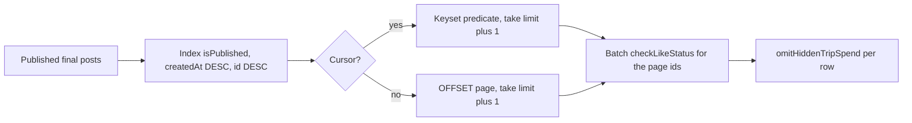

# Feed, discover, and posts

Three read models sit on top of trips and final posts.

| Surface | Route | What it lists |
| --- | --- | --- |
| Home | `GET /api/feed/home` | Published `TripFinalPost` rows |
| Happening now | `GET /api/feed/live-trips` | One ongoing trip per person, story rail |
| Discover | `GET /api/discover/trips` | Other people's ongoing and ended trips, ranked |
| Deeplink | `GET /api/posts/:entityType/:entityId` | One published final post |

Primary files: `src/app/api/feed/home/route.ts`, `src/app/api/feed/live-trips/route.ts`, `src/app/api/discover/trips/route.ts`, `src/app/api/posts/[entityType]/[entityId]/route.ts`, `src/lib/feedCursor.ts`, `src/lib/tripSpendVisibility.ts`, `mobile/lib/providers/feed_provider.dart`.

There is also a `src/app/api/feed` mention of discover in older docs. The live discover route is `/api/discover/trips`, not under `/feed`.

## Home feed

Authenticated, rate preset `read_hot` (240 per minute), timer name `get_home_feed`.

A post is included when `isPublished` is true and the trip owner is any of:

1. The viewer.
2. Someone the viewer follows.
3. A public account (`isPrivate = false`).

The three conditions are `OR`. Public posts are on the home feed even when the viewer does not follow the author. Private authors appear only as self or as a follow. The mobile provider also drops items that look private and unfollowed, in case a stale client cache disagrees with the server.

Pagination: `page` and `limit` (1–100, default 20) still work. If `cursor` is set, offset is forced to 0 and the cursor wins. `feedCursor.ts` encodes base64url `{ createdAt, id }`. The filter is "rows strictly older than this `(createdAt, id)` pair", matching `orderBy: [{ createdAt: "desc" }, { id: "desc" }]`. The query takes `limit + 1`. If the extra row exists, `hasNext` is true and `nextCursor` is the last returned row.

`Promise.all` runs the count (without the cursor) and the page together. The card does not call `_count` for entries or participants. It reads `Trip.entryCount` and `Trip.participantCount`. Likes on the page are one `checkLikeStatus(userId, TRIP_FINAL_POST, ids)` rather than one query per card.

`FeedProvider` stores `_homeFeedCursor` and sends it on load-more. It only advances `page` when the response has no `nextCursor`, so old servers and new servers both work. Like state is copied into `EngagementProvider` unless a toggle for that id is already in flight, so a feed refresh does not clobber a tap that has not returned.

## Live trips

`GET /api/feed/live-trips`. Default rate preset (`general`), not `read_hot`.

Query: `status = ONGOING`, and the owner or a participant is the viewer or someone they follow. `take: 60`, `orderBy: updatedAt desc`.

Then in memory:

- Keep the trip if the viewer is owner or participant, or follows the owner, or the owner is public.
- Deduplicate to one trip per user id. The viewer's own trip wins. For a followee, their owned trip wins over a trip they only joined.
- Sort the viewer first, then by `updatedAt`.

Spend uses `omitHiddenTripSpend` with the real membership flag. The rail is "Happening now" on the home screen. `FeedProvider.loadLiveTrips` calls `ApiService.getLiveTrips`.

The 60 row cap is a bound on work, not a product promise that a user with more than 60 live follows sees all of them. Dedup happens after the cap, so a very active graph can drop a followee who sorted below the cut.

## Discover

`GET /api/discover/trips`. `read_hot`.

Excludes the viewer's own trips (`userId != currentUserId`). Default statuses are `ONGOING` and `ENDED` (upcoming trips stay off discover). Optional `status`, `mood`, and `q`. `q` is trimmed to 80 characters and matched with `ILIKE` against title, description, owner name, username, and destinations.

Audience `OR`: the owner is someone the viewer follows, or the owner is public.

Ranking is raw SQL, then a single Prisma `findMany` by those ids:

1. Followed owners first (`followedRank`).
2. `(entryCount + participantCount) DESC`.
3. `ONGOING` before `ENDED`.
4. `updatedAt DESC`.

The id list is applied in memory with a `Map` so Prisma's `IN` clause cannot reorder the page. That is one ranked query plus one hydration query, not one query per trip.

Pagination is offset. `hasNext = offset + limit < total`. There is no discover cursor.

Spend is passed through `omitHiddenTripSpend(trip, false)`. Discover never treats the viewer as a member, even if they are. Only `spendVisibleOnDiscover` reveals the total. That is stricter than the trip detail route, which does reveal spend to members.

`FeedProvider` keeps a generation token so a slow search cannot overwrite a newer one, and it dedupes an in-flight refresh.

## Post deeplink

`GET /api/posts/:entityType/:entityId`. `read_hot`.

`TRIP_FINAL_POST`: load post, trip, and owner. **404** if it is not published. The owner can always read it. Anyone can read it when the owner is public. A private owner requires a `Follow` row, otherwise **403**. The payload includes the denormalized counts and `checkLikeStatus` for that single id.

`TRIP_THREAD_ENTRY`: **404** with a message that direct view is not supported. Thread deep links go to `GET /trips/:id/entries/:entryId/context` instead, because an entry only makes sense inside the thread window.

Share links (`/shares/:shareToken` and `/share/...` on the web host) resolve the token and then land on this post. See [Engagements](./12-engagements.md).

## Why the feed stays cheap

The expensive version of this endpoint is: for each of 20 posts, count likes, count comments, count entries, count participants, and ask "did I like this?". That is on the order of 100 queries per page.

The shipped version is: one count, one page query that uses `(isPublished, createdAt DESC, id DESC)`, one `IN` query for the viewer's likes, and columns that were maintained at write time. Discover adds one raw SQL ranking query and reuses the same columns (`entryCount`, `participantCount`) as the sort keys, which is why those counters have to stay correct in the entry and participant transactions. If they drift, discover order drifts with them.
