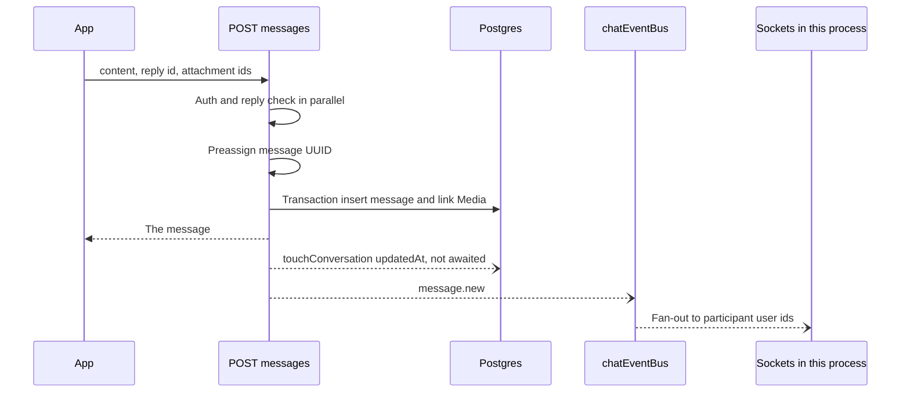

# Chat

Direct messages, groups, and one room per trip. History is REST. Delivery to other open clients is a WebSocket on the same Node process as the API.

Primary files:

- `src/lib/services/chat.ts`
- `src/lib/chat-ws.ts` (built to `dist/chat-ws.cjs`)
- `src/lib/chat-events.ts`
- `lib/chat-events-bus.cjs` (loaded by `server.cjs` onto `global.chatEventBus`)
- `server.cjs`
- Routes under `src/app/api/chat/`
- Mobile: `chat_provider.dart`, `chat_socket_service.dart`, `conversation_list_screen.dart`, `chat_screen.dart`, `new_conversation_screen.dart`, `group_settings_screen.dart`
- Proxy: `mobile/nginx.conf` upgrades `/chat`

`next dev` alone does not serve the socket. Local realtime needs `node server.cjs` (or the Docker backend service). The mobile socket comments say this explicitly.

## Data model

`Conversation.type` is `DM`, `GROUP`, or `TRIP`. A trip room has `tripId` unique, so there is at most one conversation per trip. `name` and `avatarUrl` are group and trip display fields. Trip rooms default the name to the trip title. `createdById` is the user who created the room, set null if that user is deleted. For an existing group it is backfilled as the earliest admin. The creator is who `assertCreatorMayAdd` checks when someone is added.

`ConversationParticipant`: `role` `MEMBER` or `ADMIN`, `joinedAt`, `lastReadAt`, `leftAt`. Unique `(conversationId, userId)`. Indexes `(userId)` and `(userId, lastReadAt)`. Leaving sets `leftAt`. It does not delete the row, so history and "you left" stay coherent. A later trip sync does not clear `leftAt`. Leaving the chat is not leaving the trip, and the reverse is also true: trip leave does not automatically mean the product re-adds you to a chat you left.

`ChatMessage`: `content` text, `replyToMessageId` (self-relation, `onDelete: SetNull`), `deletedAt`, `createdAt`. Indexes `(conversationId, createdAt DESC)` and `(senderId)`. Attachments are `Media` rows with `chatMessageId`.

## REST

| Route | Behavior |
| --- | --- |
| `GET /api/chat/conversations` | Rooms the caller has not left, ordered by `conversations.updatedAt DESC` (that index is the list sort) |
| `POST /api/chat/conversations` | Create DM, group, or open the trip room |
| `GET /api/chat/conversations/:id` | Detail, participants |
| `PATCH /api/chat/conversations/:id` | Rename or avatar, admin |
| `GET /api/chat/conversations/:id/messages` | History |
| `POST /api/chat/conversations/:id/messages` | Send. Preset `chat_message`, 30 per minute |
| `PATCH /api/chat/conversations/:id/messages/:messageId` | Edit inside 15 minutes |
| `DELETE` the same | Soft delete inside 15 minutes |
| `POST .../participants` | Add. Group cap **16** including existing members |
| `PATCH .../participants/:userId` | Promote or demote |
| `DELETE .../participants/:userId` | Remove |
| `POST .../leave` | Set `leftAt` |
| `PATCH .../read` | Set `lastReadAt` |

DM create looks up an existing room between the two users (`findExistingDM`) and returns it instead of inserting a second pair. Before the room is reused or created, `assertCanDirectMessage` rejects the pair when either person has a Restrict or Block row against the other. The history stays. Group and trip rooms are not closed by Restrict. Group create makes the caller `ADMIN`. Adding a member to a group the caller created also runs `assertCreatorMayAdd`.

`GET /api/chat/conversations/:id/media` pages the room's image, gif, and video attachments. `GET /api/chat/conversations/:id/media/:mediaId/context` returns one window centered on the attachment that was tapped, the same shape as a thread-entry context window. The phone opens `media_gallery_viewer.dart` immediately with that attachment, then replaces the strip with the window. The shared-media grid still pages with the list route.

Trip create calls `getOrCreateTripConversation`. Adding or removing trip participants updates the room membership with `createMany` rather than one insert per person. A user who already left is not forced back in on that sync.

## Send path

`sendMessage` checks membership through `getCachedParticipantIds` (in-process LRU, 30 seconds, 2000 conversations). A membership change calls `invalidateParticipantCache`. The cache is not shared across processes.

Edit and delete use `MESSAGE_EDIT_DELETE_WINDOW_MS` of 15 minutes, the same window as thread text edits, but here it applies to the sender only. Delete sets `deletedAt` and clears `content`. The row stays so reply threads and "this message was deleted" still render. `getMessages` returns deleted rows on purpose.

History: `before` is a message id. The query takes `limit + 1` on `(conversationId, createdAt DESC)`. Default page **30**, max **100**. Content length cap is 512 characters.

## Unread

`listConversations` used to count unread messages once per room. It now calls `batchFetchUnreadCounts`, one SQL `GROUP BY conversationId` for the whole page: messages in those rooms, newer than that participant's `lastReadAt`, not sent by the viewer, not deleted. The index `(conversationId, createdAt DESC)` serves the per-room range. The `(userId, lastReadAt)` index serves "which of my rooms are behind".

`PATCH .../read` writes `lastReadAt` and publishes `conversation.read` to `signalRecipients`. A direct message that is restricted or blocked publishes no receipt. In a group, Block drops the receipt both ways, and Restrict drops the restrictor's receipt for the person they restricted.

## WebSocket

`server.cjs` upgrades the HTTP request when the path is `/chat` and calls `attachChatWebSocket`.

Protocol:

- The first client message is the JWT, not a query string. The token has to arrive within **10 seconds** or the socket is closed.
- Heartbeat every **30 seconds**, grace **10 seconds**.
- One user can have several sockets (`connectionsByUserId`), so two devices both get `message.new`.
- Events: `message.new`, `message.updated`, `message.deleted`, `typing`, `conversation.read`, `presence.update`.
- Typing uses `signalRecipients`, so a blocked or restricted direct message does not broadcast "is typing", and a group does not send the restrictor's typing to the person they restricted.
- `presence.update` drops recipients in `presenceHiddenRecipientIds`: a block both ways, and a restrict from the person who went online or offline to the person they restricted. The restricted person's own last seen still reaches the restrictor.

The Next.js route bundle and the WebSocket bundle are separate compiles. They share the bus only because `server.cjs` assigns `global.chatEventBus` before either runs, and `chat-events.ts` publishes to `global.chatEventBus` when it is present. A unit test that imports the service without that global simply does not fan out. That is expected.

## Single node

This fan-out is correct for one container, which is how Docker and the current Railway start command run (`node server.cjs`). Two replicas behind a load balancer would split sockets across processes. A message saved on replica A would not reach a socket on replica B.

Upstash Redis in this project is REST. REST cannot hold a `SUBSCRIBE` connection, so pointing the bus at the existing Redis client would not work. A real pub/sub (Redis TCP, or another broker) is the scale-out step. Until then, chat is documented as single-process. The HTTP healthcheck does not open `/chat`, so a broken upgrade can still look healthy.

## Mobile

`ChatSocketService` connects to `AppConfig.chatWebSocketHttpOrigin` with the `ws` scheme and path `/chat`, then sends the access token. `ChatProvider` merges `message.new` into the open thread and the conversation list. REST remains the source of truth on reconnect: the client refetches the latest page rather than trusting a gapless socket log.

Tests: `chat_provider_test.dart`, `chat_message_test.dart`.
