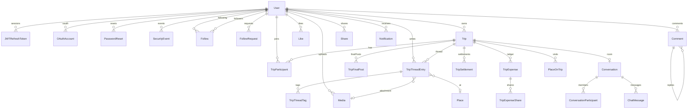

# Data model

Source of truth: `prisma/schema.prisma`. PostgreSQL, UUID primary keys, Prisma relation mode. Table names are snake case via `@@map`. This page is the map. Behavior of each cluster is in the feature chapter linked from [the index](./README.md).

## Identity

### User (`users`)

`id`, `email` unique, `username` unique nullable, `name`, `password` nullable (Google-only), `avatarUrl`, `bio`, `isPrivate` default false, `createdAt`, `updatedAt`, `deletedAt`, `deleteMeta` JSON.

No denormalized follower counts. Stats are `count()` queries.

### OAuthAccount (`oauth_accounts`)

`provider` (`GOOGLE`, `APPLE`), `providerUserId`, `userId`. Unique `(provider, providerUserId)`. Apple is unused.

### JWTRefreshToken (`jwt_refresh_tokens`)

`refreshToken` unique, `expiresAt`, `userId`. Indexes `userId`, `expiresAt`.

### PasswordReset (`password_resets`)

`tokenHash` bytes unique, `otpCodeHash` bytes nullable unused, `expiresAt`, `usedAt`, `createdIp`, `userAgent`. Index `(userId, expiresAt)`.

### SecurityEvent (`security_events`)

`eventType`, optional user and entity, `ipAddress`, `metadata` JSON, `createdAt`. Indexes on type+time, user+time, entity.

## Social graph

### Follow (`follows`)

`followerId`, `followeeId`, `createdAt`. Unique pair. Index `followeeId`.

### FollowRequest (`follow_requests`)

Same pair, `status` `PENDING | ACCEPTED | REJECTED`. Unique pair. Index `(followeeId, status, createdAt DESC)`.

### Notification (`notifications`)

`type` `LIKE | COMMENT_LIKE | COMMENT | COMMENT_REPLY | TAG | FOLLOW`, `actorId`, `recipientId`, `readAt`, optional entity, `metadata`. Indexes `(recipientId, createdAt DESC, id DESC)` and `(recipientId, readAt)`.

## Trips

### Trip (`trips`)

Identity and schedule: `userId` (owner), `title`, `description`, `startDate`, `endDate` nullable, `scheduleTimezone` nullable, `destinations` string array, `mood`, `type`, `typeSetByUser` default false, `status` default `UPCOMING`.

Counters: `entryCount` default 0, `participantCount` default 1.

Cover: `coverMediaId` nullable, `ON DELETE SET NULL`.

Places: `startLocationId`, `endLocationId`, optional `centerLat`, `centerLng`, `boundNeLat`, `boundNeLng`, `boundSwLat`, `boundSwLng`.

Money: `expenseCurrency` default `INR`, `totalSpendMinor` default 0, `spendVisibleOnDiscover` default false.

Indexes: `(userId, status)`, `(userId, createdAt DESC)`, `(status, endDate)`, `(status, startDate)`.

The owner is not a `TripParticipant` row. Every feature that means "members" must add `userId` by hand. The participants GET synthesizes `role: "owner"`.

### TripParticipant (`trip_participants`)

`tripId`, `userId`, `role` default `"member"` (a string, not an enum), `joinedAt`. Unique `(tripId, userId)`. Index `userId`.

### TripJoinRequest (`trip_join_requests`)

`tripId`, `senderId`, `receiverId`, `status` `PENDING | ACCEPTED | REJECTED`. Unique `(tripId, receiverId)`. Index `(receiverId, status)`. This is an invite, not a user-initiated join request.

### TripThreadEntry (`trip_thread_entries`)

`tripId`, `authorId`, `type` `TEXT | MEDIA | LOCATION`, `contentText`, `mediaId`, `locationName`, `gpsCoordinates` JSON, `placeId`, `likeCount`, `commentCount`, `createdAt`.

Indexes: `(tripId, createdAt DESC, id DESC)`, `(authorId, createdAt DESC)`.

### TripThreadTag (`trip_thread_tags`)

`threadEntryId`, `taggedUserId`. Unique pair.

### TripFinalPost (`trip_final_posts`)

`tripId`, `userId`, `summaryText`, `curatedMedia` string array, `caption`, `coverMediaUrl`, `generationStatus` default `DRAFT`, `isPublished` default false, `publishedAt`, counters `likeCount`, `commentCount`, `shareCount`.

Unique `(tripId, userId)`. Indexes `tripId`, `(userId, isPublished, publishedAt)`, and `(isPublished, createdAt DESC, id DESC)`.

### UserSafetyRelation (`user_safety_relations`)

`actorId`, `targetId`, `action` `RESTRICT | BLOCK`, `createdAt`, `updatedAt`. Unique `(actorId, targetId)`. Indexes `(actorId, action, createdAt DESC, id DESC)` and `(targetId, action)`. Restrict and Block are not follow rows.

## Places and media

### Place (`places`)

`name`, `address`, `lat`, `lng`, `placeType` default `POI`, `source` default `USER`, `externalId` unique. Indexes `coordinate_spatial_idx (lat, lng)`, `external_id_idx (externalId)`.

`PlaceType`: `POI`, `STAY`, `FOOD`, `TRANSPORT`, `VIEWPOINT`, `OTHER`.

`PlaceSource`: `USER`, `GOOGLE`, `MAPBOX`, `APPLE`.

### PlaceOnTrip (`places_on_trip`)

`tripId`, `placeId`, `visitedAt`, `dayIndex`, `notes`, `order`. Unique `(tripId, placeId, visitedAt)`. Index `trip_visits_idx (tripId, visitedAt)`.

### PlaceShare (`place_shares`)

`placeId`, optional `tripId`, optional `threadEntryId`, `token` unique, `expiresAt`, `createdById`. No public route module.

### Media (`media`)

`url`, `publicId` unique, `type` `IMAGE | VIDEO | AUDIO | GIF`, `filename`, `size`, `width`, `height`, `duration`, `processingStatus` default `COMPLETED`, `uploadedById`, optional `tripId`, optional `chatMessageId`.

Indexes: `chatMessageId`, `tripId`, `(uploadedById, createdAt DESC)`.

## Money

### TripExpense (`trip_expenses`)

`tripId`, `createdById`, `payerId`, `title`, `category`, `amountMinor`, `currency`, `splitMethod`, `note`, `deletedAt`. Indexes `(tripId, createdAt)`, `(tripId, deletedAt)`, `payerId`.

### TripExpenseShare (`trip_expense_shares`)

`expenseId`, `userId`, `shareMinor`, `weight` nullable. Unique `(expenseId, userId)`. Index `userId`.

### TripSettlement (`trip_settlements`)

`tripId`, `fromUserId`, `toUserId`, `amountMinor`, `currency`, `status` default `PAID`, `recordedById`, `createdAt`. No update column. Indexes `(tripId, createdAt)`, `fromUserId`, `toUserId`.

Enums: `ExpenseCategory`, `ExpenseSplitMethod` (`EQUAL`, `EXACT`, `PERCENT`, `SHARES`), `TripSettlementStatus` (`PAID`, `PENDING`, `COMPLETED`, `FAILED`, `CANCELLED`, `DISPUTED`). Net math uses `PAID` and `COMPLETED` only.

## Engagement

`EntityType`: `TRIP_FINAL_POST`, `TRIP_THREAD_ENTRY`, `COMMENT`.

### Like

`userId`, `entityType`, `entityId`, `createdAt`. Unique triple. Indexes `(entityType, entityId, createdAt)`, `(userId, createdAt DESC)`. The user relation does not cascade in the schema snippet (`@relation` without `onDelete`). Account deletion deletes likes explicitly in the user-delete transaction.

### Comment

`userId`, `entityType`, `entityId`, `contentText` varchar 250, `parentCommentId`, `likeCount`, timestamps. Indexes `(entityType, entityId, createdAt)`, `(parentCommentId, createdAt DESC)`, `userId`. Replies are one level.

### Share

`userId`, `entityType`, `entityId`, `shareToken` unique, `shareType` (`DEEP_LINK`, `WEB_LINK`, `EXTERNAL`), `expiresAt`, `metadata` JSON. Indexes `(userId, createdAt)`, `(entityType, entityId)`. `ShareSource` (`SYSTEM_SHEET`, `IN_APP_DM`) is a request argument, not a column.

## Chat

### Conversation (`conversations`)

`type` `DM | GROUP | TRIP`, `tripId` unique nullable, `name`, `avatarUrl`, `createdById` nullable, timestamps. Indexes `tripId`, `type`, `updatedAt DESC`. `createdBy` uses `onDelete: SetNull`.

### ConversationParticipant (`conversation_participants`)

`conversationId`, `userId`, `role` `MEMBER | ADMIN`, `joinedAt`, `lastReadAt`, `leftAt`. Unique pair. Indexes `userId`, `(userId, lastReadAt)`.

### ChatMessage (`chat_messages`)

`conversationId`, `senderId`, `content` text, `replyToMessageId`, `deletedAt`, timestamps. Indexes `(conversationId, createdAt DESC)`, `senderId`.

## Enum index

| Enum | Values |
| --- | --- |
| `NotificationType` | `LIKE`, `COMMENT_LIKE`, `COMMENT`, `COMMENT_REPLY`, `TAG`, `FOLLOW` |
| `SecurityEventType` | `COMMENT_REPORT`, `PROFANITY_DETECTED`, `RATE_LIMIT_HIT`, `ABUSE_DETECTED`, `UNAUTHORIZED_ACCESS` |
| `OAuthProvider` | `GOOGLE`, `APPLE` |
| `FollowRequestStatus` | `PENDING`, `ACCEPTED`, `REJECTED` |
| `TripStatus` | `UPCOMING`, `ONGOING`, `ENDED` |
| `TripMood` | `RELAXED`, `ADVENTURE`, `SPIRITUAL`, `CULTURAL`, `PARTY`, `MIXED` |
| `TripType` | `SOLO`, `GROUP`, `COUPLE`, `FAMILY` |
| `ThreadEntryType` | `TEXT`, `MEDIA`, `LOCATION` |
| `MediaType` | `IMAGE`, `VIDEO`, `AUDIO`, `GIF` |
| `MediaProcessingStatus` | `PENDING`, `PROCESSING`, `COMPLETED`, `FAILED` |
| `TripJoinRequestStatus` | `PENDING`, `ACCEPTED`, `REJECTED` |
| `GenerationStatus` | `DRAFT`, `GENERATING`, `READY`, `PUBLISHED`, `FAILED` |
| `EntityType` | `TRIP_FINAL_POST`, `TRIP_THREAD_ENTRY`, `COMMENT` |
| `ShareType` | `DEEP_LINK`, `WEB_LINK`, `EXTERNAL` |
| `ConversationType` | `DM`, `GROUP`, `TRIP` |
| `ConversationParticipantRole` | `MEMBER`, `ADMIN` |
| `PlaceType` | `POI`, `STAY`, `FOOD`, `TRANSPORT`, `VIEWPOINT`, `OTHER` |
| `PlaceSource` | `USER`, `GOOGLE`, `MAPBOX`, `APPLE` |
| `ExpenseCategory` | `FOOD`, `STAY`, `TRANSPORT`, `ACTIVITIES`, `SHOPPING`, `OTHER` |
| `ExpenseSplitMethod` | `EQUAL`, `EXACT`, `PERCENT`, `SHARES` |
| `TripSettlementStatus` | `PAID`, `PENDING`, `COMPLETED`, `FAILED`, `CANCELLED`, `DISPUTED` |

## Migrations that changed the shape

Hot-path indexes and the spatial indexes are explained in [Optimizations](./18-optimizations.md). Other migrations worth knowing when you read old rows:

| Migration | Effect |
| --- | --- |
| `20250824064635` / `20250824065154` | Follow request schema and mapping |
| `20250830185131` | Trip join requests (invites) |
| `20251011183851` | Place and map columns |
| `20251017185022` | Password reset and security events |
| `20251028181650` | Spatial and external-id indexes |
| `20251111185636` | Media / Cloudinary columns |
| `20251117140447` | Final post fields |
| `20251229191439` / `20251229192236` | Engagement tables |
| `20260113000000` | `usedAt` on password reset |
| `20260120000000` | Notifications |
| `20260203143916` | Security events and like uniqueness |
| `20260203192921` | `Comment.likeCount` |
| `20260223000000` | `FOLLOW` notification type |
| `20260303000000` | Chat tables |
| `20260613173812` | Conversation avatar |
| `20260914120000` | Expense ledger |
| `20261004153000` / `20261004180000` | Hot-path indexes |
| `20261014150000` | Open-ended schedule, `scheduleTimezone` |
| `20261031120000` | Remove check-in entry type |
| `20261111120000_personalized_final_posts` | One final post per `(tripId, userId)`. Old rows belong to the trip owner |
| `20261111120000_user_safety_and_conversation_creator` | `UserSafetyRelation`, and `conversations.createdById` |
