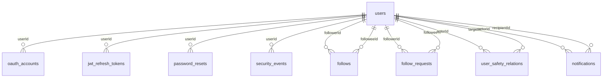
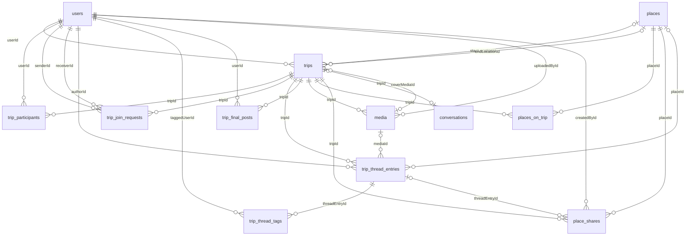
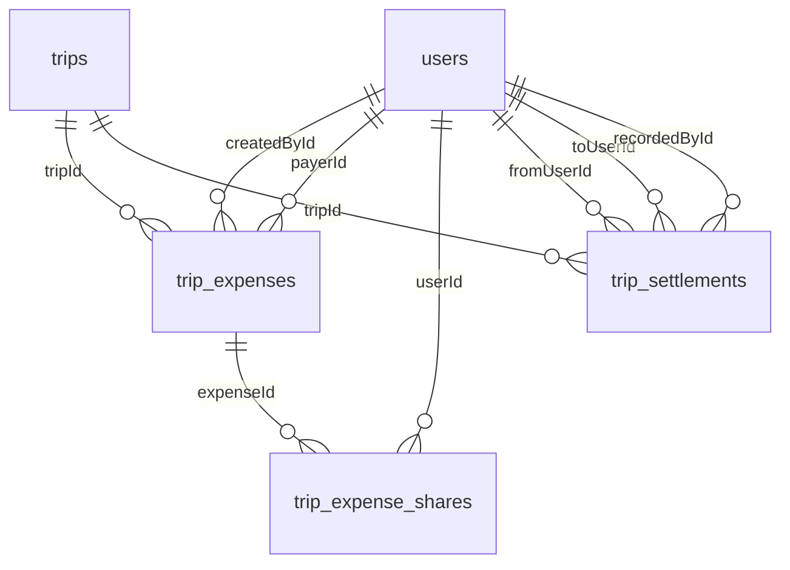
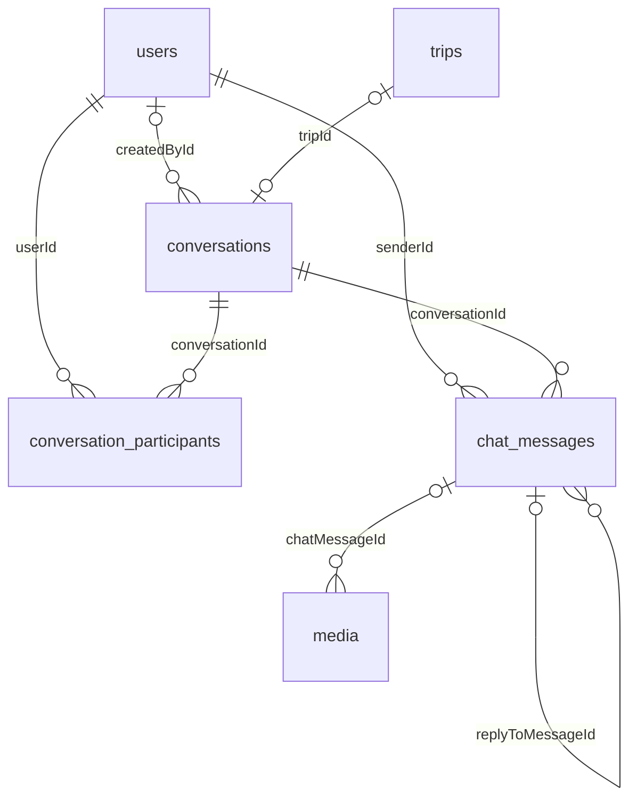
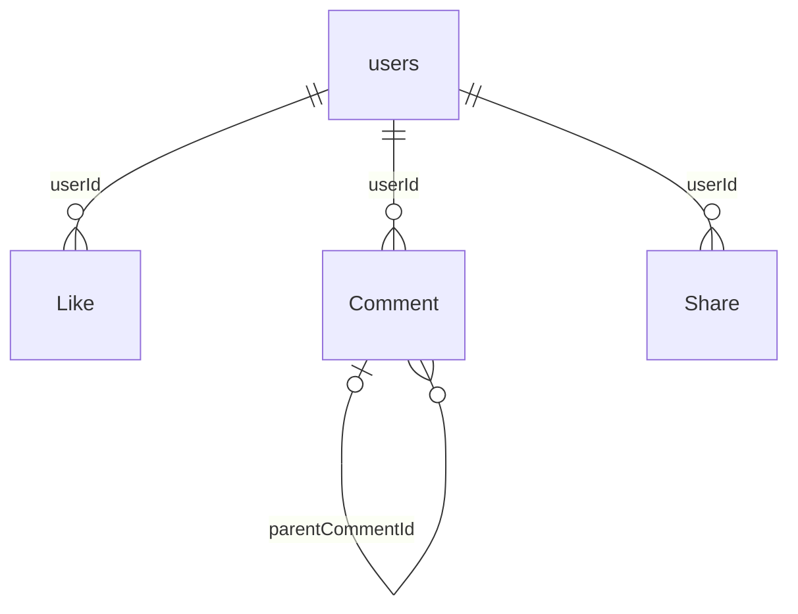
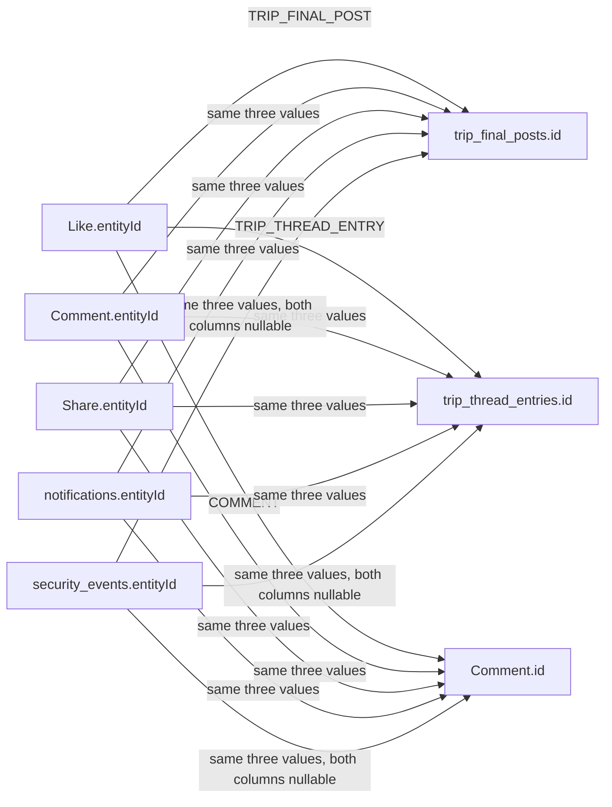

# Data model

Source of truth: `prisma/schema.prisma` on this handbook branch. PostgreSQL, UUID primary keys, foreign keys enforced by the database. Most tables are snake case via `@@map`. `Like`, `Comment`, and `Share` keep those PascalCase table names because those models have no `@@map`. Behavior of each cluster is in the feature chapter linked from [the index](./README.md).

There are 28 tables. The pictures below use the PostgreSQL names. A line is a real foreign key. `entityType` plus `entityId` is not a foreign key. That pair is drawn separately.

## Entity-relationship diagram

Cardinality is read from the entity on the left toward the entity on the right. `||--o{` is one to zero-or-more. `|o--o|` is zero-or-one to zero-or-one. The label is the column that holds the foreign key.

### Identity and safety

`follows` and `follow_requests` each store the pair twice as two foreign keys to `users`. `user_safety_relations.actorId` is the person who restricted or blocked. `targetId` is the other person. One row per pair.

### Trip, thread, places, and media

The trip owner is `trips.userId`. That person is not inserted into `trip_participants`. A final post is one row per `(tripId, userId)`, so the owner and each participant each have their own draft. `conversations.tripId` is unique, so a trip has at most one trip room.

### Money

### Chat

### Engagement

`Like`, `Comment`, and `Share` also store `entityType` and `entityId`. Those two columns do not reference another table. The application decides which row they mean.

`EntityType` is `TRIP_FINAL_POST`, `TRIP_THREAD_ENTRY`, or `COMMENT`. Deleting a final post or a thread entry does not cascade into `Like`, `Comment`, `Share`, or `notifications`. The service deletes those rows itself.

## Schema diagram

This is the same database drawn as the foreign-key direction. The arrow starts on the table that stores the column and points at the table and column it references. `CASCADE` deletes the child when the parent goes away. `SET NULL` clears the column. `RESTRICT` refuses the parent delete while a child row exists.

```mermaid
flowchart TB
  subgraph identity [Identity]
    users["users"]
    oauth_accounts["oauth_accounts"]
    jwt_refresh_tokens["jwt_refresh_tokens"]
    password_resets["password_resets"]
    security_events["security_events"]
  end
  subgraph social [Social]
    follows["follows"]
    follow_requests["follow_requests"]
    user_safety_relations["user_safety_relations"]
    notifications["notifications"]
  end
  subgraph tripgraph [Trip]
    trips["trips"]
    trip_participants["trip_participants"]
    trip_join_requests["trip_join_requests"]
    trip_thread_entries["trip_thread_entries"]
    trip_thread_tags["trip_thread_tags"]
    trip_final_posts["trip_final_posts"]
    places["places"]
    places_on_trip["places_on_trip"]
    place_shares["place_shares"]
    media["media"]
  end
  subgraph money [Money]
    trip_expenses["trip_expenses"]
    trip_expense_shares["trip_expense_shares"]
    trip_settlements["trip_settlements"]
  end
  subgraph chat [Chat]
    conversations["conversations"]
    conversation_participants["conversation_participants"]
    chat_messages["chat_messages"]
  end
  subgraph engagement [Engagement]
    Like["Like"]
    Comment["Comment"]
    Share["Share"]
  end

  oauth_accounts -->|userId CASCADE| users
  jwt_refresh_tokens -->|userId CASCADE| users
  password_resets -->|userId CASCADE| users
  security_events -->|userId SET NULL| users
  follows -->|followerId CASCADE| users
  follows -->|followeeId CASCADE| users
  follow_requests -->|followerId CASCADE| users
  follow_requests -->|followeeId CASCADE| users
  user_safety_relations -->|actorId CASCADE| users
  user_safety_relations -->|targetId CASCADE| users
  notifications -->|actorId CASCADE| users
  notifications -->|recipientId CASCADE| users

  trips -->|userId CASCADE| users
  trips -->|coverMediaId SET NULL| media
  trips -->|startLocationId SET NULL| places
  trips -->|endLocationId SET NULL| places
  trip_participants -->|tripId CASCADE| trips
  trip_participants -->|userId CASCADE| users
  trip_join_requests -->|tripId CASCADE| trips
  trip_join_requests -->|senderId CASCADE| users
  trip_join_requests -->|receiverId CASCADE| users
  trip_thread_entries -->|tripId CASCADE| trips
  trip_thread_entries -->|authorId CASCADE| users
  trip_thread_entries -->|mediaId SET NULL| media
  trip_thread_entries -->|placeId SET NULL| places
  trip_thread_tags -->|threadEntryId CASCADE| trip_thread_entries
  trip_thread_tags -->|taggedUserId CASCADE| users
  trip_final_posts -->|tripId CASCADE| trips
  trip_final_posts -->|userId CASCADE| users
  media -->|uploadedById CASCADE| users
  media -->|tripId CASCADE| trips
  media -->|chatMessageId SET NULL| chat_messages
  places_on_trip -->|tripId CASCADE| trips
  places_on_trip -->|placeId RESTRICT| places
  place_shares -->|placeId CASCADE| places
  place_shares -->|tripId CASCADE| trips
  place_shares -->|threadEntryId SET NULL| trip_thread_entries
  place_shares -->|createdById RESTRICT| users

  trip_expenses -->|tripId CASCADE| trips
  trip_expenses -->|createdById CASCADE| users
  trip_expenses -->|payerId CASCADE| users
  trip_expense_shares -->|expenseId CASCADE| trip_expenses
  trip_expense_shares -->|userId CASCADE| users
  trip_settlements -->|tripId CASCADE| trips
  trip_settlements -->|fromUserId CASCADE| users
  trip_settlements -->|toUserId CASCADE| users
  trip_settlements -->|recordedById CASCADE| users

  conversations -->|tripId CASCADE| trips
  conversations -->|createdById SET NULL| users
  conversation_participants -->|conversationId CASCADE| conversations
  conversation_participants -->|userId CASCADE| users
  chat_messages -->|conversationId CASCADE| conversations
  chat_messages -->|senderId CASCADE| users
  chat_messages -->|replyToMessageId SET NULL| chat_messages

  Like -->|userId RESTRICT| users
  Comment -->|userId RESTRICT| users
  Comment -->|parentCommentId SET NULL| Comment
  Share -->|userId RESTRICT| users
```

### Every foreign key

| Child table | Column | Parent | Parent column | Rows | On delete |
| --- | --- | --- | --- | --- | --- |
| `oauth_accounts` | `userId` | `users` | `id` | many accounts, one user | CASCADE |
| `jwt_refresh_tokens` | `userId` | `users` | `id` | many tokens, one user | CASCADE |
| `password_resets` | `userId` | `users` | `id` | many resets, one user | CASCADE |
| `security_events` | `userId` | `users` | `id` | many events, one user, column nullable | SET NULL |
| `follows` | `followerId` | `users` | `id` | many rows, one follower | CASCADE |
| `follows` | `followeeId` | `users` | `id` | many rows, one followee | CASCADE |
| `follow_requests` | `followerId` | `users` | `id` | many requests, one sender | CASCADE |
| `follow_requests` | `followeeId` | `users` | `id` | many requests, one recipient | CASCADE |
| `user_safety_relations` | `actorId` | `users` | `id` | many actions, one actor | CASCADE |
| `user_safety_relations` | `targetId` | `users` | `id` | many actions, one target | CASCADE |
| `notifications` | `actorId` | `users` | `id` | many notices, one actor | CASCADE |
| `notifications` | `recipientId` | `users` | `id` | many notices, one recipient | CASCADE |
| `trips` | `userId` | `users` | `id` | many trips, one owner | CASCADE |
| `trips` | `coverMediaId` | `media` | `id` | many trips, one cover, nullable | SET NULL |
| `trips` | `startLocationId` | `places` | `id` | many trips, one start place, nullable | SET NULL |
| `trips` | `endLocationId` | `places` | `id` | many trips, one end place, nullable | SET NULL |
| `trip_participants` | `tripId` | `trips` | `id` | many members, one trip | CASCADE |
| `trip_participants` | `userId` | `users` | `id` | many memberships, one user | CASCADE |
| `trip_join_requests` | `tripId` | `trips` | `id` | many invites, one trip | CASCADE |
| `trip_join_requests` | `senderId` | `users` | `id` | many invites, one sender | CASCADE |
| `trip_join_requests` | `receiverId` | `users` | `id` | many invites, one receiver | CASCADE |
| `trip_thread_entries` | `tripId` | `trips` | `id` | many entries, one trip | CASCADE |
| `trip_thread_entries` | `authorId` | `users` | `id` | many entries, one author | CASCADE |
| `trip_thread_entries` | `mediaId` | `media` | `id` | many entries, one file, nullable | SET NULL |
| `trip_thread_entries` | `placeId` | `places` | `id` | many entries, one place, nullable | SET NULL |
| `trip_thread_tags` | `threadEntryId` | `trip_thread_entries` | `id` | many tags, one entry | CASCADE |
| `trip_thread_tags` | `taggedUserId` | `users` | `id` | many tags, one person | CASCADE |
| `trip_final_posts` | `tripId` | `trips` | `id` | many posts, one trip | CASCADE |
| `trip_final_posts` | `userId` | `users` | `id` | many posts, one author | CASCADE |
| `media` | `uploadedById` | `users` | `id` | many files, one uploader | CASCADE |
| `media` | `tripId` | `trips` | `id` | many files, one trip, nullable | CASCADE |
| `media` | `chatMessageId` | `chat_messages` | `id` | many files, one message, nullable | SET NULL |
| `places_on_trip` | `tripId` | `trips` | `id` | many visits, one trip | CASCADE |
| `places_on_trip` | `placeId` | `places` | `id` | many visits, one place | RESTRICT |
| `place_shares` | `placeId` | `places` | `id` | many shares, one place | CASCADE |
| `place_shares` | `tripId` | `trips` | `id` | many shares, one trip, nullable | CASCADE |
| `place_shares` | `threadEntryId` | `trip_thread_entries` | `id` | many shares, one entry, nullable | SET NULL |
| `place_shares` | `createdById` | `users` | `id` | many shares, one creator | RESTRICT |
| `trip_expenses` | `tripId` | `trips` | `id` | many expenses, one trip | CASCADE |
| `trip_expenses` | `createdById` | `users` | `id` | many expenses, one creator | CASCADE |
| `trip_expenses` | `payerId` | `users` | `id` | many expenses, one payer | CASCADE |
| `trip_expense_shares` | `expenseId` | `trip_expenses` | `id` | many shares, one expense | CASCADE |
| `trip_expense_shares` | `userId` | `users` | `id` | many shares, one person | CASCADE |
| `trip_settlements` | `tripId` | `trips` | `id` | many settlements, one trip | CASCADE |
| `trip_settlements` | `fromUserId` | `users` | `id` | many settlements, one debtor | CASCADE |
| `trip_settlements` | `toUserId` | `users` | `id` | many settlements, one creditor | CASCADE |
| `trip_settlements` | `recordedById` | `users` | `id` | many settlements, one recorder | CASCADE |
| `conversations` | `tripId` | `trips` | `id` | one room, one trip, nullable and unique | CASCADE |
| `conversations` | `createdById` | `users` | `id` | many rooms, one creator, nullable | SET NULL |
| `conversation_participants` | `conversationId` | `conversations` | `id` | many members, one room | CASCADE |
| `conversation_participants` | `userId` | `users` | `id` | many memberships, one user | CASCADE |
| `chat_messages` | `conversationId` | `conversations` | `id` | many messages, one room | CASCADE |
| `chat_messages` | `senderId` | `users` | `id` | many messages, one sender | CASCADE |
| `chat_messages` | `replyToMessageId` | `chat_messages` | `id` | many replies, one message, nullable | SET NULL |
| `Like` | `userId` | `users` | `id` | many likes, one user | RESTRICT |
| `Comment` | `userId` | `users` | `id` | many comments, one user | RESTRICT |
| `Comment` | `parentCommentId` | `Comment` | `id` | many replies, one parent, nullable | SET NULL |
| `Share` | `userId` | `users` | `id` | many shares, one user | RESTRICT |

Unique pairs that stop a second row for the same relationship: `follows (followerId, followeeId)`, `follow_requests (followerId, followeeId)`, `user_safety_relations (actorId, targetId)`, `oauth_accounts (provider, providerUserId)`, `trip_participants (tripId, userId)`, `trip_join_requests (tripId, receiverId)`, `trip_thread_tags (threadEntryId, taggedUserId)`, `trip_final_posts (tripId, userId)`, `trip_expense_shares (expenseId, userId)`, `conversation_participants (conversationId, userId)`, `places_on_trip (tripId, placeId, visitedAt)`, and `Like (userId, entityType, entityId)`. `conversations.tripId` is unique on its own.

### Columns that are not foreign keys

| Table | Columns | What the value means |
| --- | --- | --- |
| `Like` | `entityType`, `entityId` | `TRIP_FINAL_POST` → `trip_final_posts.id`. `TRIP_THREAD_ENTRY` → `trip_thread_entries.id`. `COMMENT` → `Comment.id` |
| `Comment` | `entityType`, `entityId` | Same three targets. `parentCommentId` is the only real foreign key besides `userId` |
| `Share` | `entityType`, `entityId` | Same three targets |
| `notifications` | `entityType`, `entityId` | Same three targets, both nullable. `actorId` and `recipientId` are the real foreign keys |
| `security_events` | `entityType`, `entityId` | Same three targets, both nullable. `userId` is the real foreign key |

`trips.userId` and `trip_participants.userId` together are the membership of a trip. Reading only `trip_participants` misses the owner.

## Identity

### User (`users`)

`id`, `email` unique, `username` unique nullable, `name`, `password` nullable (Google-only), `avatarUrl`, `bio`, `isPrivate` default false, `createdAt`, `updatedAt`, `deletedAt`, `deleteMeta` JSON.

No denormalized follower counts. Stats are `count()` queries.

### OAuthAccount (`oauth_accounts`)

`provider` (`GOOGLE`, `APPLE`), `providerUserId`, `userId`. Unique `(provider, providerUserId)`. Apple is unused.

### JWTRefreshToken (`jwt_refresh_tokens`)

`refreshToken` unique, `expiresAt`, `userId`. Indexes `userId`, `expiresAt`.

### PasswordReset (`password_resets`)

`tokenHash` bytes unique, `otpCodeHash` bytes nullable unused, `expiresAt`, `usedAt`, `createdIp`, `userAgent`. Index `(userId, expiresAt)`.

### SecurityEvent (`security_events`)

`eventType`, optional user and entity, `ipAddress`, `metadata` JSON, `createdAt`. Indexes on type+time, user+time, entity.

## Social graph

### Follow (`follows`)

`followerId`, `followeeId`, `createdAt`. Unique pair. Index `followeeId`.

### FollowRequest (`follow_requests`)

Same pair, `status` `PENDING | ACCEPTED | REJECTED`. Unique pair. Index `(followeeId, status, createdAt DESC)`.

### Notification (`notifications`)

`type` `LIKE | COMMENT_LIKE | COMMENT | COMMENT_REPLY | TAG | FOLLOW`, `actorId`, `recipientId`, `readAt`, optional entity, `metadata`. Indexes `(recipientId, createdAt DESC, id DESC)` and `(recipientId, readAt)`.

## Trips

### Trip (`trips`)

Identity and schedule: `userId` (owner), `title`, `description`, `startDate`, `endDate` nullable, `scheduleTimezone` nullable, `destinations` string array, `mood`, `type`, `typeSetByUser` default false, `status` default `UPCOMING`.

Counters: `entryCount` default 0, `participantCount` default 1.

Cover: `coverMediaId` nullable, `ON DELETE SET NULL`.

Places: `startLocationId`, `endLocationId`, optional `centerLat`, `centerLng`, `boundNeLat`, `boundNeLng`, `boundSwLat`, `boundSwLng`.

Money: `expenseCurrency` default `INR`, `totalSpendMinor` default 0, `spendVisibleOnDiscover` default false.

Indexes: `(userId, status)`, `(userId, createdAt DESC)`, `(status, endDate)`, `(status, startDate)`.

The owner is not a `TripParticipant` row. Every feature that means "members" must add `userId` by hand. The participants GET synthesizes `role: "owner"`.

### TripParticipant (`trip_participants`)

`tripId`, `userId`, `role` default `"member"` (a string, not an enum), `joinedAt`. Unique `(tripId, userId)`. Index `userId`.

### TripJoinRequest (`trip_join_requests`)

`tripId`, `senderId`, `receiverId`, `status` `PENDING | ACCEPTED | REJECTED`. Unique `(tripId, receiverId)`. Index `(receiverId, status)`. This is an invite, not a user-initiated join request.

### TripThreadEntry (`trip_thread_entries`)

`tripId`, `authorId`, `type` `TEXT | MEDIA | LOCATION`, `contentText`, `mediaId`, `locationName`, `gpsCoordinates` JSON, `placeId`, `likeCount`, `commentCount`, `createdAt`.

Indexes: `(tripId, createdAt DESC, id DESC)`, `(authorId, createdAt DESC)`.

### TripThreadTag (`trip_thread_tags`)

`threadEntryId`, `taggedUserId`. Unique pair.

### TripFinalPost (`trip_final_posts`)

`tripId`, `userId`, `summaryText`, `curatedMedia` string array, `caption`, `coverMediaUrl`, `generationStatus` default `DRAFT`, `isPublished` default false, `publishedAt`, counters `likeCount`, `commentCount`, `shareCount`. The API and the scheduler set `generationStatus` to `DRAFT` when they create the personal draft. `isPublished` stays false until that person publishes. `READY` remains on the enum and is not assigned. Migration `20261113180000_relabel_ready_final_posts_as_draft` rewrites stored `READY` rows to `DRAFT`.

Unique `(tripId, userId)`. Indexes `tripId`, `(userId, isPublished, publishedAt)`, and `(isPublished, createdAt DESC, id DESC)`.

### UserSafetyRelation (`user_safety_relations`)

`actorId`, `targetId`, `action` `RESTRICT | BLOCK`, `createdAt`, `updatedAt`. Unique `(actorId, targetId)`. Indexes `(actorId, action, createdAt DESC, id DESC)` and `(targetId, action)`. Restrict and Block are not follow rows.

## Places and media

### Place (`places`)

`name`, `address`, `lat`, `lng`, `placeType` default `POI`, `source` default `USER`, `externalId` unique. Indexes `coordinate_spatial_idx (lat, lng)`, `external_id_idx (externalId)`.

`PlaceType`: `POI`, `STAY`, `FOOD`, `TRANSPORT`, `VIEWPOINT`, `OTHER`.

`PlaceSource`: `USER`, `GOOGLE`, `MAPBOX`, `APPLE`.

### PlaceOnTrip (`places_on_trip`)

`tripId`, `placeId`, `visitedAt`, `dayIndex`, `notes`, `order`. Unique `(tripId, placeId, visitedAt)`. Index `trip_visits_idx (tripId, visitedAt)`.

### PlaceShare (`place_shares`)

`placeId`, optional `tripId`, optional `threadEntryId`, `token` unique, `expiresAt`, `createdById`. No public route module.

### Media (`media`)

`url`, `publicId` unique, `type` `IMAGE | VIDEO | AUDIO | GIF`, `filename`, `size`, `width`, `height`, `duration`, `processingStatus` default `COMPLETED`, `uploadedById`, optional `tripId`, optional `chatMessageId`.

Indexes: `chatMessageId`, `tripId`, `(uploadedById, createdAt DESC)`.

## Money

### TripExpense (`trip_expenses`)

`tripId`, `createdById`, `payerId`, `title`, `category`, `amountMinor`, `currency`, `splitMethod`, `note`, `deletedAt`. Indexes `(tripId, createdAt)`, `(tripId, deletedAt)`, `payerId`.

### TripExpenseShare (`trip_expense_shares`)

`expenseId`, `userId`, `shareMinor`, `weight` nullable. Unique `(expenseId, userId)`. Index `userId`.

### TripSettlement (`trip_settlements`)

`tripId`, `fromUserId`, `toUserId`, `amountMinor`, `currency`, `status` default `PAID`, `recordedById`, `createdAt`. No update column. Indexes `(tripId, createdAt)`, `fromUserId`, `toUserId`.

Enums: `ExpenseCategory`, `ExpenseSplitMethod` (`EQUAL`, `EXACT`, `PERCENT`, `SHARES`), `TripSettlementStatus` (`PAID`, `PENDING`, `COMPLETED`, `FAILED`, `CANCELLED`, `DISPUTED`). Net math uses `PAID` and `COMPLETED` only.

## Engagement

`EntityType`: `TRIP_FINAL_POST`, `TRIP_THREAD_ENTRY`, `COMMENT`.

### Like

`userId`, `entityType`, `entityId`, `createdAt`. Unique triple. Indexes `(entityType, entityId, createdAt)`, `(userId, createdAt DESC)`. The user relation does not cascade in the schema snippet (`@relation` without `onDelete`). Account deletion deletes likes explicitly in the user-delete transaction.

### Comment

`userId`, `entityType`, `entityId`, `contentText` varchar 250, `parentCommentId`, `likeCount`, timestamps. Indexes `(entityType, entityId, createdAt)`, `(parentCommentId, createdAt DESC)`, `userId`. Replies are one level.

### Share

`userId`, `entityType`, `entityId`, `shareToken` unique, `shareType` (`DEEP_LINK`, `WEB_LINK`, `EXTERNAL`), `expiresAt`, `metadata` JSON. Indexes `(userId, createdAt)`, `(entityType, entityId)`. `ShareSource` (`SYSTEM_SHEET`, `IN_APP_DM`) is a request argument, not a column.

## Chat

### Conversation (`conversations`)

`type` `DM | GROUP | TRIP`, `tripId` unique nullable, `name`, `avatarUrl`, `createdById` nullable, timestamps. Indexes `tripId`, `type`, `updatedAt DESC`. `createdBy` uses `onDelete: SetNull`.

### ConversationParticipant (`conversation_participants`)

`conversationId`, `userId`, `role` `MEMBER | ADMIN`, `joinedAt`, `lastReadAt`, `leftAt`. Unique pair. Indexes `userId`, `(userId, lastReadAt)`.

### ChatMessage (`chat_messages`)

`conversationId`, `senderId`, `content` text, `replyToMessageId`, `deletedAt`, timestamps. Indexes `(conversationId, createdAt DESC)`, `senderId`.

## Enum index

| Enum | Values |
| --- | --- |
| `NotificationType` | `LIKE`, `COMMENT_LIKE`, `COMMENT`, `COMMENT_REPLY`, `TAG`, `FOLLOW` |
| `SecurityEventType` | `COMMENT_REPORT`, `PROFANITY_DETECTED`, `RATE_LIMIT_HIT`, `ABUSE_DETECTED`, `UNAUTHORIZED_ACCESS` |
| `OAuthProvider` | `GOOGLE`, `APPLE` |
| `FollowRequestStatus` | `PENDING`, `ACCEPTED`, `REJECTED` |
| `UserSafetyAction` | `RESTRICT`, `BLOCK` |
| `TripStatus` | `UPCOMING`, `ONGOING`, `ENDED` |
| `TripMood` | `RELAXED`, `ADVENTURE`, `SPIRITUAL`, `CULTURAL`, `PARTY`, `MIXED` |
| `TripType` | `SOLO`, `GROUP`, `COUPLE`, `FAMILY` |
| `ThreadEntryType` | `TEXT`, `MEDIA`, `LOCATION` |
| `MediaType` | `IMAGE`, `VIDEO`, `AUDIO`, `GIF` |
| `MediaProcessingStatus` | `PENDING`, `PROCESSING`, `COMPLETED`, `FAILED` |
| `TripJoinRequestStatus` | `PENDING`, `ACCEPTED`, `REJECTED` |
| `GenerationStatus` | `DRAFT`, `GENERATING`, `READY`, `PUBLISHED`, `FAILED` |
| `EntityType` | `TRIP_FINAL_POST`, `TRIP_THREAD_ENTRY`, `COMMENT` |
| `ShareType` | `DEEP_LINK`, `WEB_LINK`, `EXTERNAL` |
| `ConversationType` | `DM`, `GROUP`, `TRIP` |
| `ConversationParticipantRole` | `MEMBER`, `ADMIN` |
| `PlaceType` | `POI`, `STAY`, `FOOD`, `TRANSPORT`, `VIEWPOINT`, `OTHER` |
| `PlaceSource` | `USER`, `GOOGLE`, `MAPBOX`, `APPLE` |
| `ExpenseCategory` | `FOOD`, `STAY`, `TRANSPORT`, `ACTIVITIES`, `SHOPPING`, `OTHER` |
| `ExpenseSplitMethod` | `EQUAL`, `EXACT`, `PERCENT`, `SHARES` |
| `TripSettlementStatus` | `PAID`, `PENDING`, `COMPLETED`, `FAILED`, `CANCELLED`, `DISPUTED` |

## Migrations that changed the shape

Hot-path indexes and the spatial indexes are explained in [Optimizations](./18-optimizations.md). Other migrations worth knowing when you read old rows:

| Migration | Effect |
| --- | --- |
| `20250824064635` / `20250824065154` | Follow request schema and mapping |
| `20250830185131` | Trip join requests (invites) |
| `20251011183851` | Place and map columns |
| `20251017185022` | Password reset and security events |
| `20251028181650` | Spatial and external-id indexes |
| `20251111185636` | Media / Cloudinary columns |
| `20251117140447` | Final post fields |
| `20251229191439` / `20251229192236` | Engagement tables |
| `20260113000000` | `usedAt` on password reset |
| `20260120000000` | Notifications |
| `20260203143916` | Security events and like uniqueness |
| `20260203192921` | `Comment.likeCount` |
| `20260223000000` | `FOLLOW` notification type |
| `20260303000000` | Chat tables |
| `20260613173812` | Conversation avatar |
| `20260914120000` | Expense ledger |
| `20261004153000` / `20261004180000` | Hot-path indexes |
| `20261014150000` | Open-ended schedule, `scheduleTimezone` |
| `20261031120000` | Remove check-in entry type |
| `20261111120000_personalized_final_posts` | One final post per `(tripId, userId)`. Old rows belong to the trip owner |
| `20261111120000_user_safety_and_conversation_creator` | `UserSafetyRelation`, and `conversations.createdById` |
| `20261113180000_relabel_ready_final_posts_as_draft` | Data only. Stored `READY` rows become `DRAFT`. The enum value stays |
