# Architecture diagram

This is the whole application on one page: who talks to whom, which process owns which data, and how a trip moves through the system. The diagrams are [Mermaid](https://mermaid.js.org/). Miro can import them (board menu, **Import**, or paste into a Mermaid frame, depending on your Miro plan). Each fenced block is one frame. Import them as separate frames on one board, left to right, in the order below.

Nothing here is a new runtime. It is the structure in `server.cjs`, `src/`, `mobile/`, `scheduler/`, and `prisma/schema.prisma`.

## 1. System context

Who is outside the codebase, and who is inside.

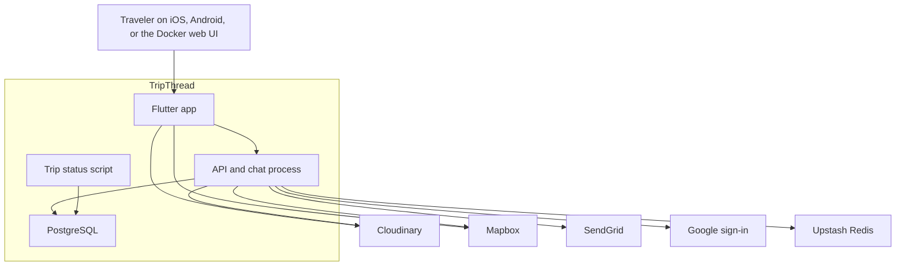

The phone uploads bytes to Cloudinary and draws Mapbox tiles itself. The API only signs uploads, confirms them, and geocodes search text. The status script never calls Redis, Cloudinary, or Mapbox.

## 2. Containers and processes

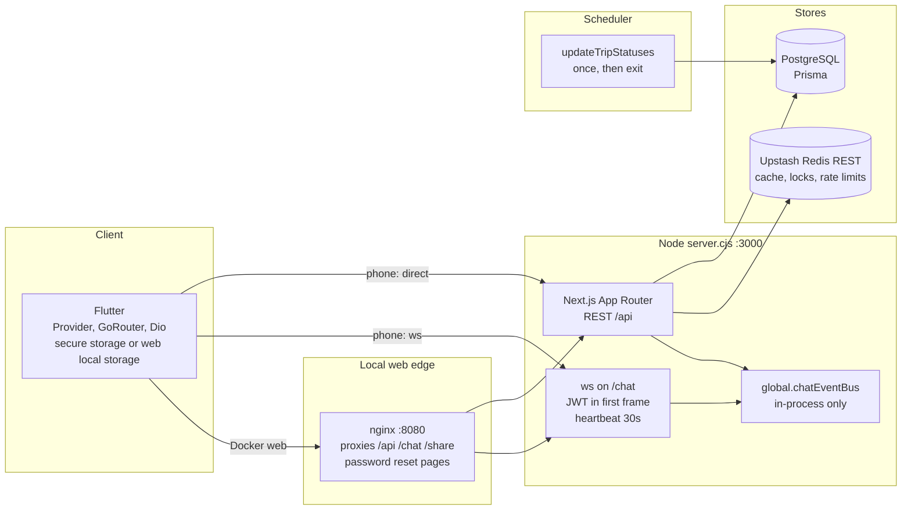

Production on Railway runs `node server.cjs` from Railpack. The nginx box is the Docker web image, not a production edge you have to deploy separately for the native apps.

## 3. API domains inside the one process

Every box is a folder of route handlers plus a service module. They share one Prisma client and one Redis client pair. They are not network services.

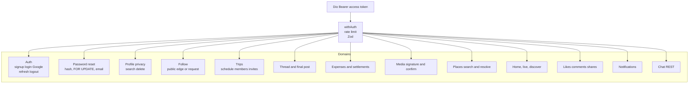

Rate presets sit on the middleware, not inside each domain. Auth routes use the small auth windows. Feed, profile, and notifications use `read_hot` at 240 per minute. Chat send uses `chat_message` at 30 per minute. The numbers are in [Redis](./09-redis-cache-and-queues.md).

## 4. Full runtime diagram

This is the board to pin as the large frame. Solid arrows are request paths. The scheduler and the chat bus are called out so they are not mistaken for Redis jobs.

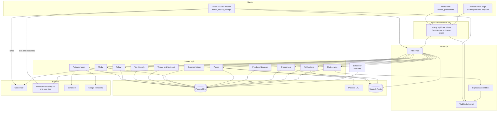

Read this frame with three rules:

1. Redis is beside the API, not beside the scheduler, and not on the chat bus.
2. Cloudinary is reached by the phone for bytes and by the API for signatures, magic-number reads, and deletes.
3. Mapbox is reached by the phone for tiles and by the API for place search.

## 5. Session and password

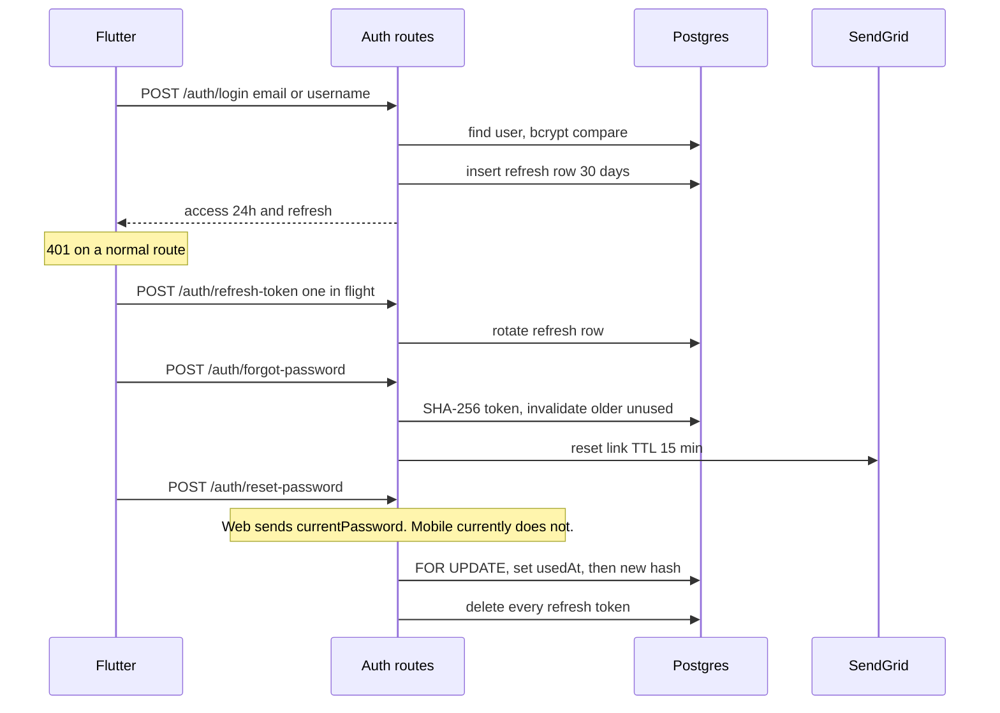

## 6. Trip life, from create to the feed

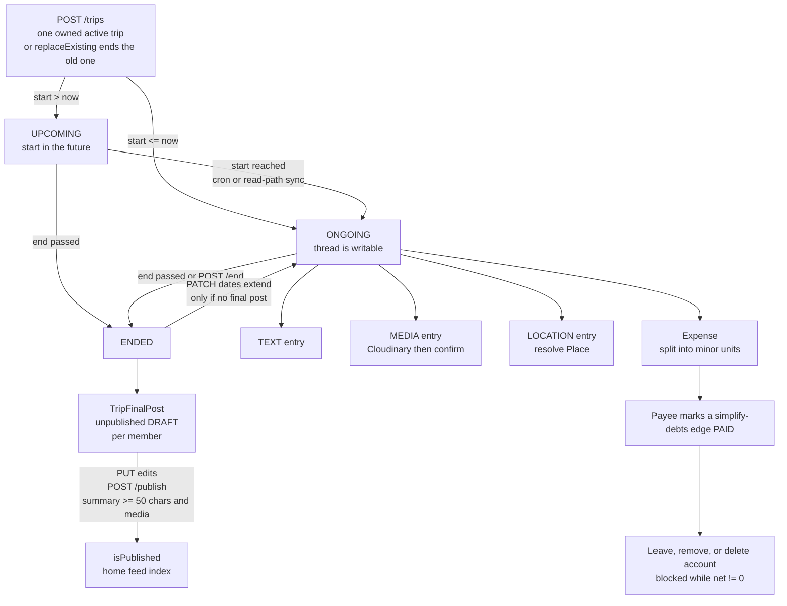

Members are the owner (`trips.userId`) plus `trip_participants`. The owner is not inserted into the participant table. Invites are `trip_join_requests`. A private owner can only invite people who already follow them.

Chat: create ensures a `TRIP` conversation. Leaving that room does not leave the trip. The next participant sync does not undo a chat leave.

## 7. Social and privacy

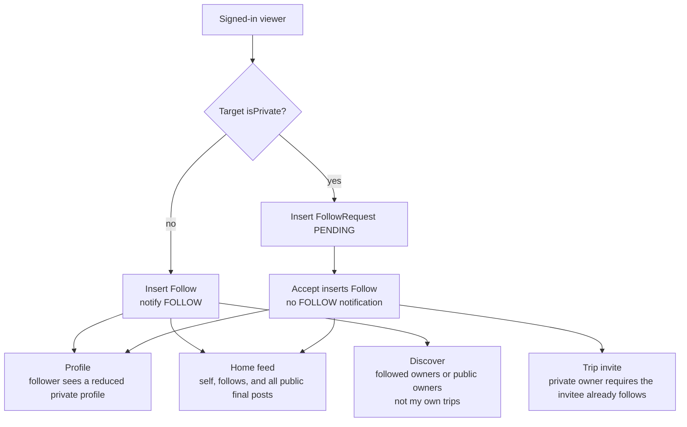

Unfollow deletes the follow edge and every request between the pair. Restrict and Block live on `user_safety_relations`, not on `follows`. Block also deletes the target's follow of the actor.

## 8. Media and places

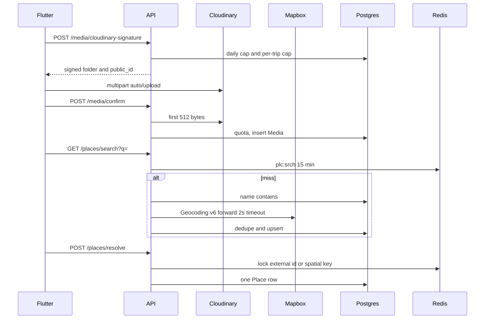

Pin labels on the map do not use this sequence. The device geocoder names the pin, then resolve stores the coordinates. Location permission is while-in-use only.

## 9. Feed, engagement, inbox

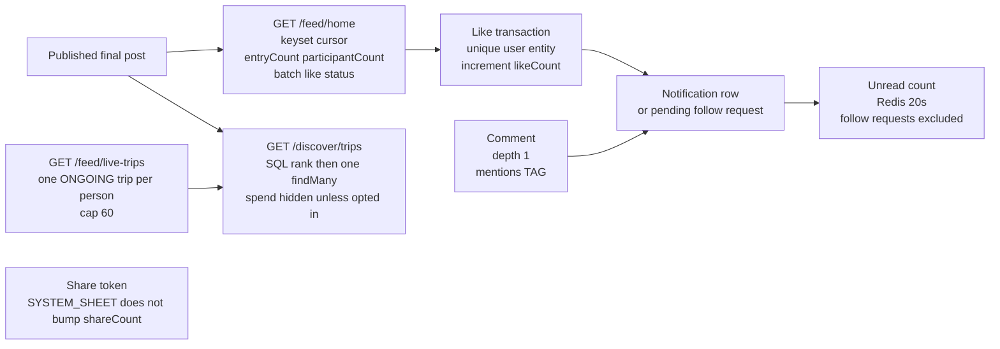

`GET /posts/TRIP_FINAL_POST/:id` is the deeplink. Thread entries are not opened on that route. They use the thread context window.

## 10. Money

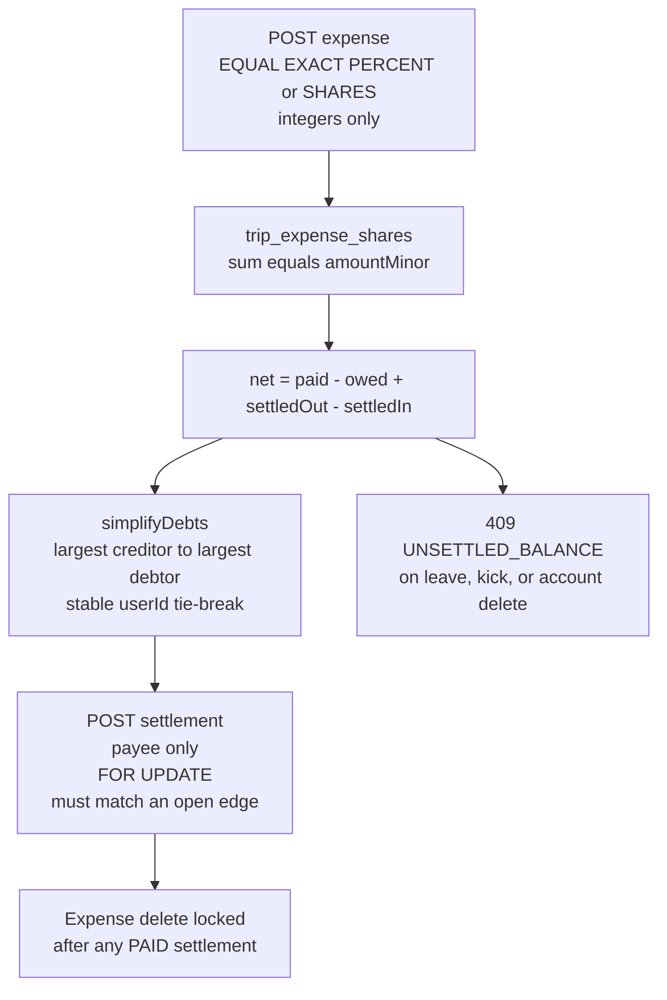

No payment provider is called. `PAID` means the payee tapped Mark as paid.

## 11. Chat delivery

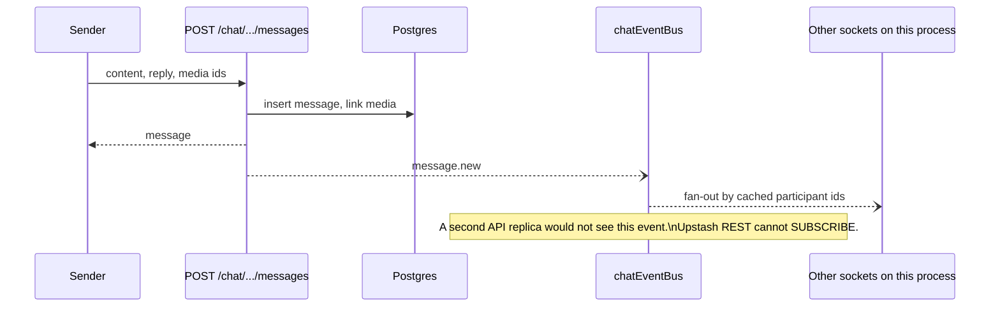

History on reconnect is REST, cursor `before` message id. Unread counts for the room list are one `GROUP BY`, not one count per room.

## 12. Data stores by domain

Paste this as a table frame next to the large diagram.

| Store | Holds | Does not hold |
| --- | --- | --- |
| PostgreSQL | Users, sessions, resets, follows, trips, entries, final posts, places, media rows, expenses, settlements, likes, comments, shares, notifications, conversations, messages | File bytes, map tiles, email |
| Upstash Redis | Place search and identity, unread badge, share token, rate-limit windows, resolve locks, cache locks | Jobs, chat pub/sub, scheduler state |
| Process memory | LRU in front of Redis, chat participant LRU, chat event bus, performance timings, last 1000 errors | Anything that must survive a restart |
| Cloudinary | Image and video bytes, `public_id` under `tripthread_uploads/{userId}` | The `Media` row. That is Postgres |
| Mapbox | Geocoding responses and, on device, tiles | Canonical places. Those are Postgres after resolve |
| Phone secure store | Access and refresh tokens on iOS and Android | The web Docker build, which uses local storage |

## 13. Hot indexes on the same board

These are the indexes a reader should be able to point at from the feed, thread, inbox, and scheduler frames. The full why is [Optimizations](./18-optimizations.md).

| Index | Frame it belongs to |
| --- | --- |
| `trip_final_posts (isPublished, createdAt DESC, id DESC)` | Home feed |
| `trip_thread_entries (tripId, createdAt DESC, id DESC)` | Thread |
| `trips (status, endDate)` and `(status, startDate)` | Scheduler |
| `trips (userId, status)` | One active owned trip |
| `notifications (recipientId, createdAt DESC, id DESC)` | Inbox |
| `follow_requests (followeeId, status, createdAt DESC)` | Private follow |
| `places (lat, lng)` btree `coordinate_spatial_idx` | Place resolve |
| `chat_messages (conversationId, createdAt DESC)` | Chat history and unread |
| `likes (userId, entityType, entityId)` unique | Like idempotency |

## How to lay the Miro board

Suggested columns, left to right:

1. Clients and nginx.
2. `server.cjs` with REST, WebSocket, and the in-process bus.
3. The domain row from section 3.
4. PostgreSQL in the center bottom, Redis to its right, external systems above Redis.
5. The scheduler as its own sticky, with an arrow only into PostgreSQL.
6. Under the domain row, the four sequence frames: session, trip life, media and places, chat.
7. The index table as a legend along the bottom.

Color is optional. If you color anything, use one color for "writes Postgres", one for "calls an external API", and leave Redis and the scheduler uncolored except for their own borders, so the two common misconceptions stay visible: Redis is not the queue, and the scheduler is not part of the API process.
